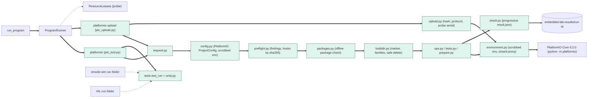
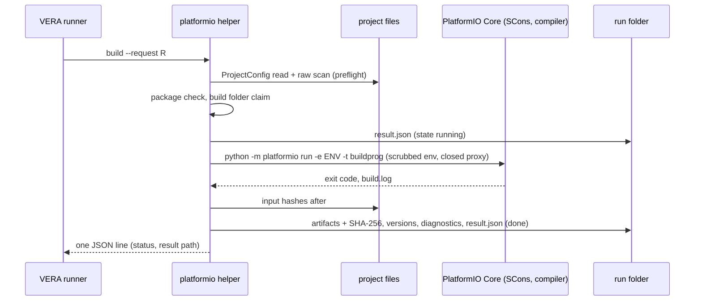
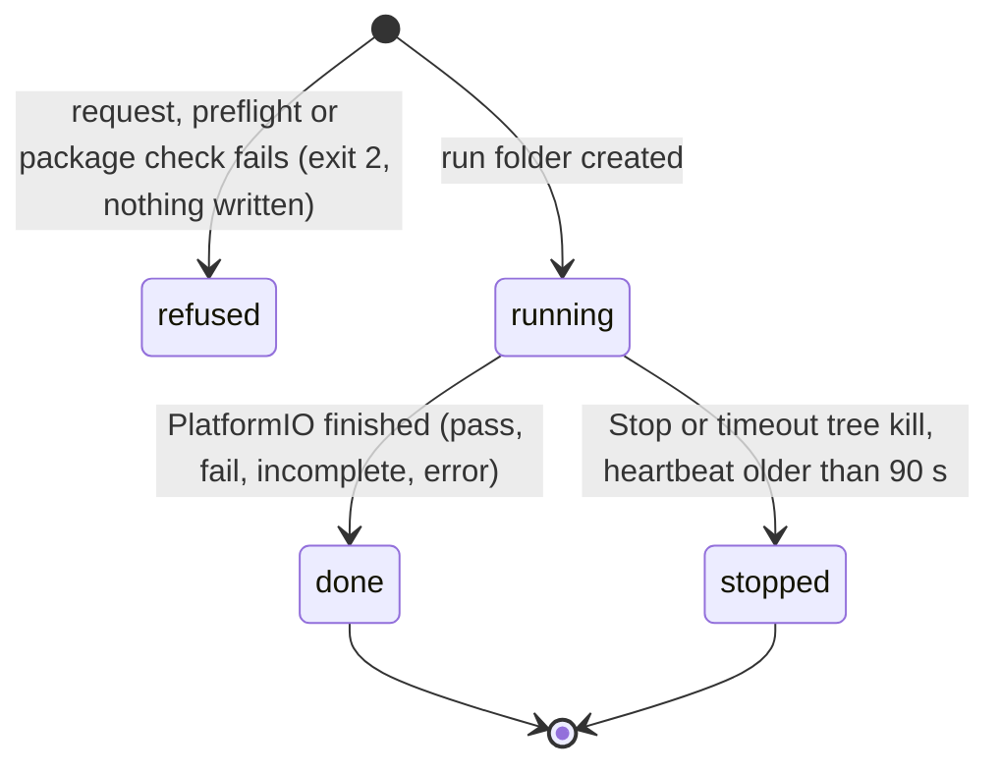

# TASK-b3344846 diagrams

Illustrates `## Design` in `TASK-b3344846.md`. The Design text is authoritative.

Node map: added - platformio program (pio_tool.py), platformio-upload program, request, config (ProjectConfig),
preflight, packages, environment, builddir, ops/tests/prepare, unity, upload, result; unchanged - VERA runner, leases,
renode-sim, HIL executor, lab/resources.json, PlatformIO Core.

## Structure

## Sequence

## State

