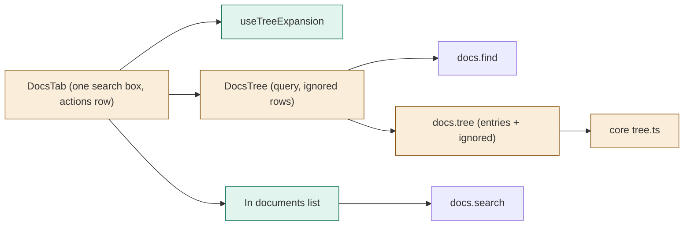
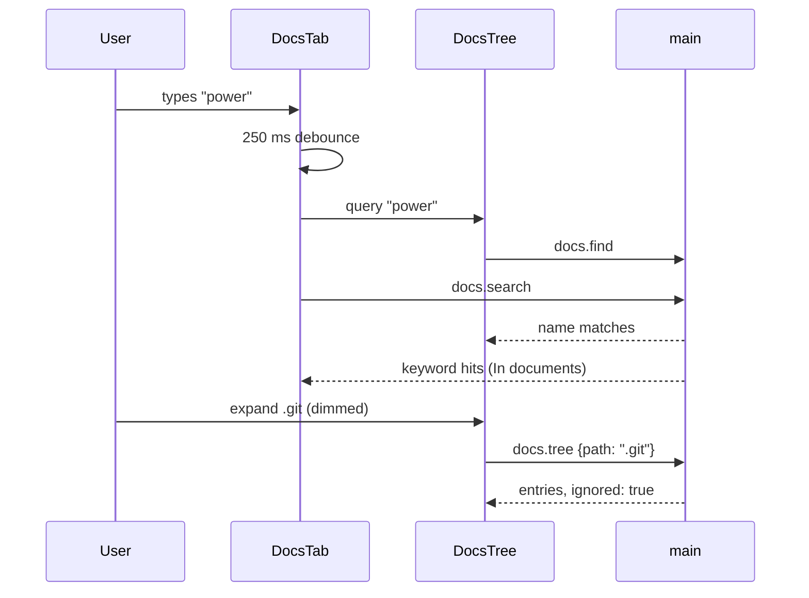

# TASK-b34f2cc7 diagrams

Illustrates `## Design` in `TASK-b34f2cc7.md`. The Design text is authoritative.

| Node | Class |
|---|---|
| useTreeExpansion, .docs-actions row, In documents list | added |
| DocsTab, DocsTree, core tree.ts listFolder/readText/statEntry, docsTreeEntrySchema, mockApi | changed |
| docs.find, docs.search, findFiles, readIgnorePolicy | unchanged (reused) |

## Structure

## Sequence

## State

Not drawn: the search box is empty or has text; the tree switches between browsing and
filtered views on that alone.
