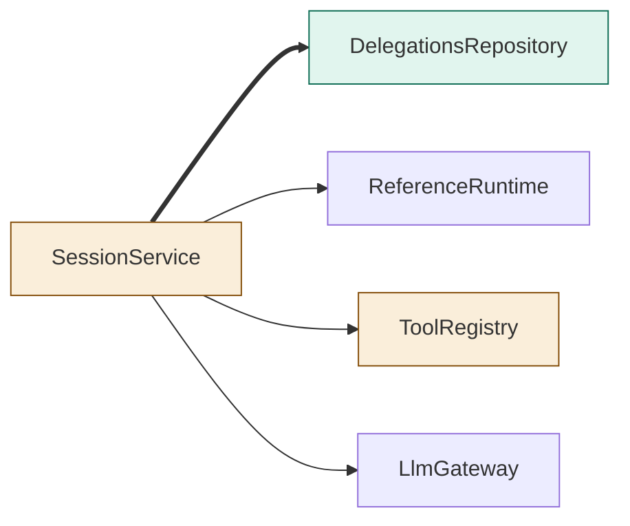
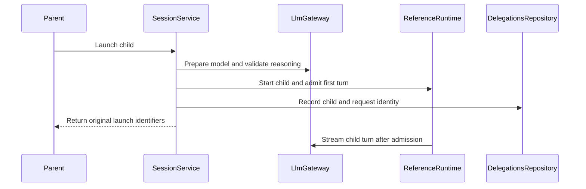
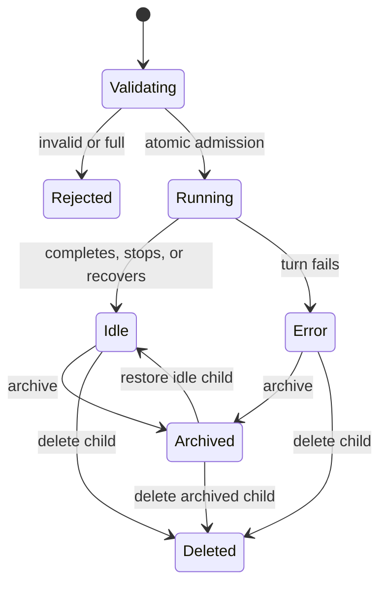

# TASK-b6bdee40 diagrams

Illustrates the Design in TASK-b6bdee40.md.

## Structure

SessionService and ToolRegistry change. DelegationsRepository is added. ReferenceRuntime and the gateway are reused.

## Sequence

## State

