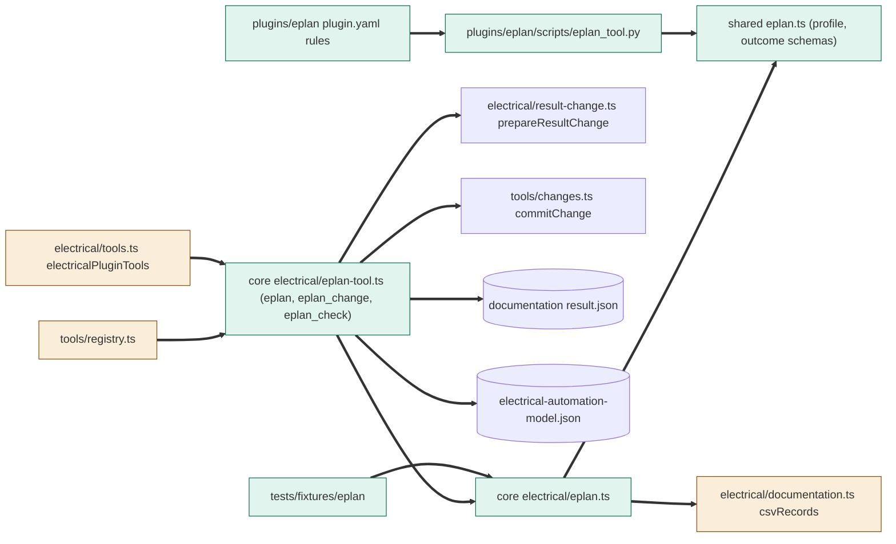
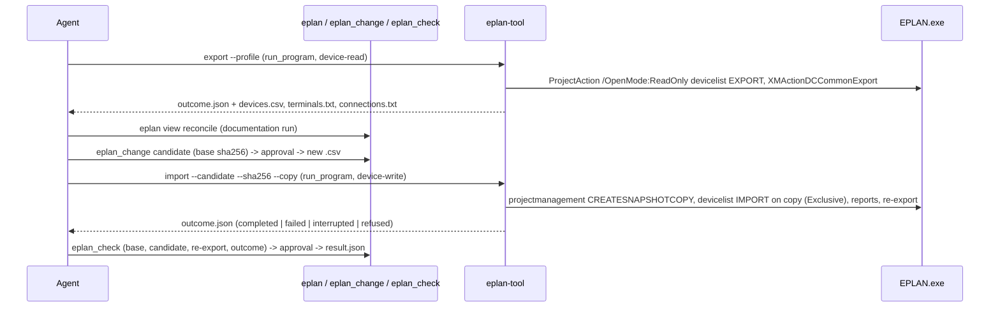
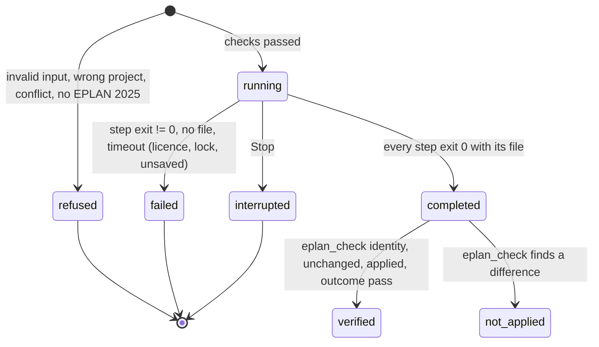

# TASK-b74c88bb diagrams

Illustrates `## Design` in `TASK-b74c88bb.md`. The Design text is authoritative.

Node map: added - shared_eplan, core_eplan, eplan_tool, helper, plugin, fixtures; changed - documentation (csvRecords
exported with a delimiter), tools_gating (new entries), registry (new tools); unchanged - result_change, commit,
doc_run, model.

## Structure

## Sequence

## State

