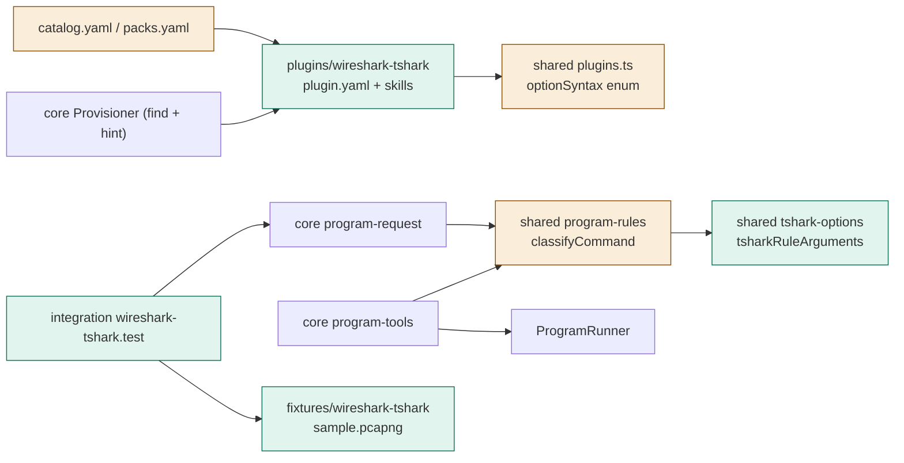
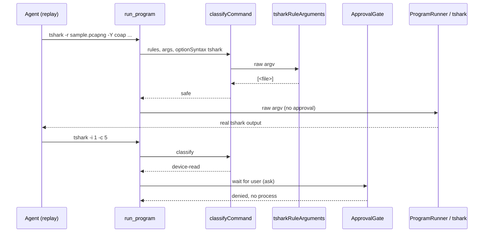

# TASK-bb2d915f diagrams

Illustrates `## Design` in `TASK-bb2d915f.md`. The Design text is authoritative.

Node map: added = tshark-options, wireshark-tshark package, fixture, integration test;
changed = plugins.ts schema (enum), program-rules classifyCommand (dispatch), catalog/packs;
unchanged = program-request, program-tools, Provisioner, ApprovalGate, ProgramRunner.

## Structure

## Sequence

## State

Not drawn: the change adds no lifecycle or status field; program states reuse the existing provisioner states.
