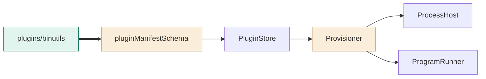
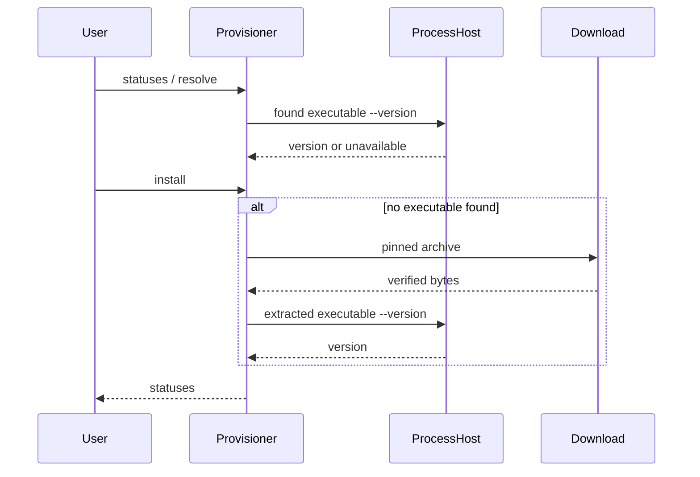

# TASK-bb6f2f0e diagrams

Illustrates Design in TASK-bb6f2f0e.md; the Design text is authoritative.

## Structure

Map: binutils package added; schema and Provisioner changed; PluginStore, ProcessHost and ProgramRunner reused unchanged.

## Sequence

## State

Not drawn: existing missing/unavailable/ready lifecycle is reused without a new status or transition.
