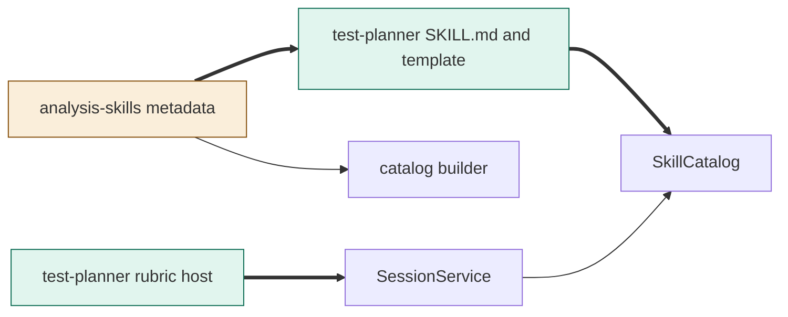
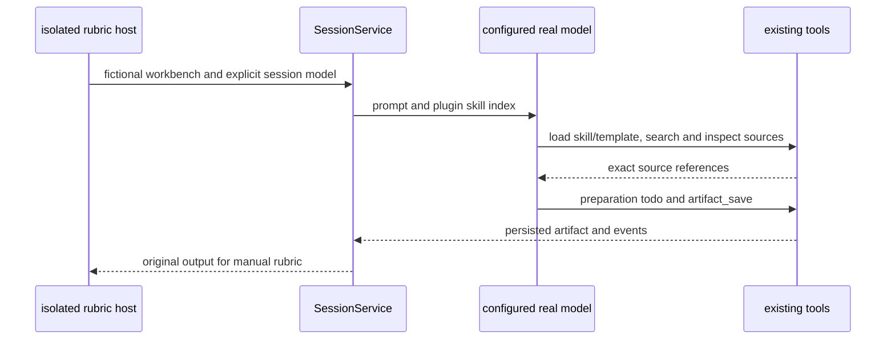

# TASK-bb97c2aa diagrams

Illustrates `## Design` in `TASK-bb97c2aa.md`. The Design text is authoritative.

## Structure

Map: test-planner body/template and rubric host added; analysis-skills metadata changed;
SkillCatalog, SessionService and catalog builder reused unchanged.

## Sequence

## State

Not drawn: this adds no runtime lifecycle or state transitions; readiness is existing Markdown output.
