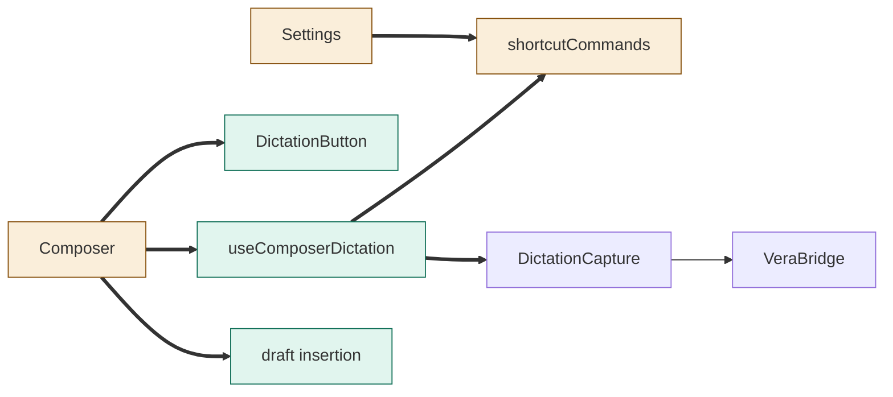
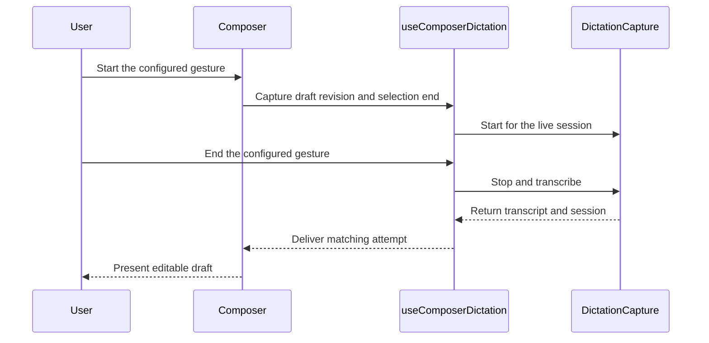
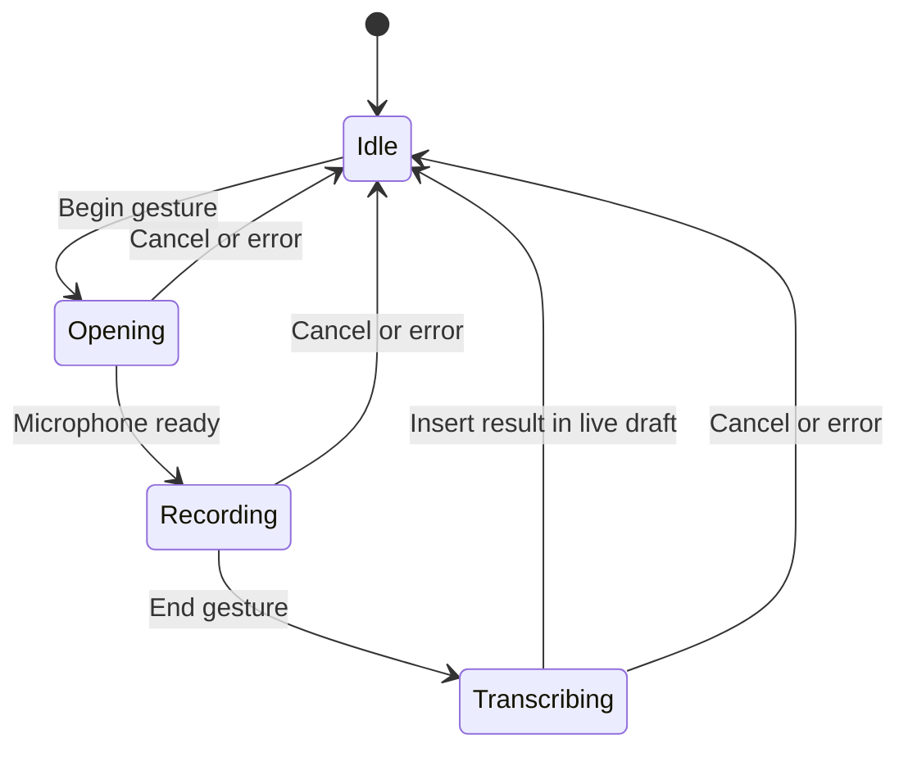

# TASK-bba6dbb3 diagrams

Illustrates the design in TASK-bba6dbb3.md.

## Structure

Added components are DictationButton, useComposerDictation and draft insertion. Settings, Composer and the shared shortcut registry gain responsibilities. DictationCapture and the typed bridge are reused.

## Sequence

## State

