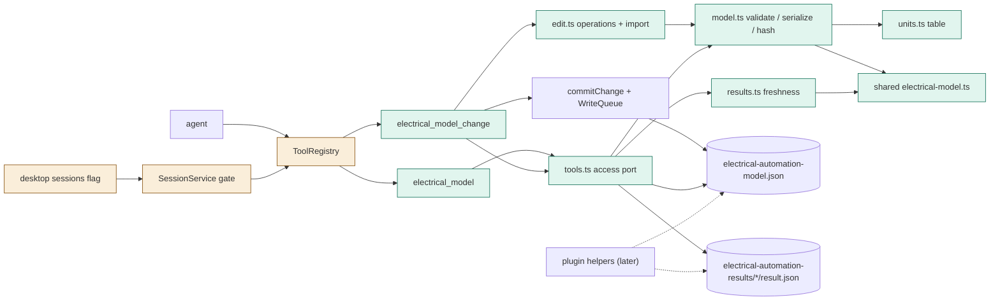
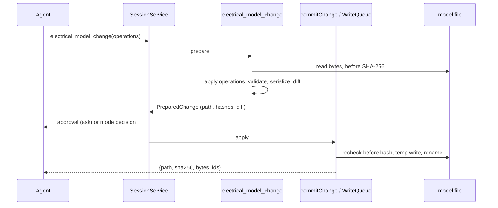
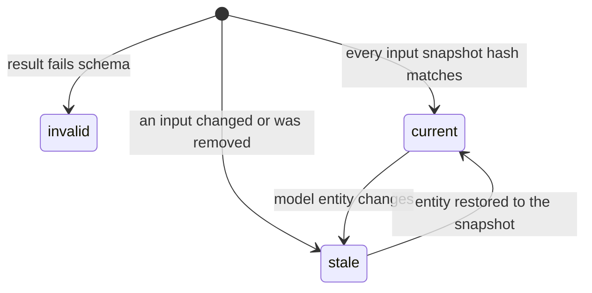

# TASK-bdafefcf diagrams

Illustrates `## Design` in `TASK-bdafefcf.md`. The Design text is authoritative.

Node map: added - shared electrical-model schemas, core units/model/edit/results/tools, fixture;
changed - ToolRegistry (two tools), SessionService (electricalModel gate), desktop sessions (flag),
FileChangeRequest tool union, workbench tools editor; unchanged - commitChange, WriteQueue, PathGuard,
approval gate, plugin helpers.

## Structure

## Sequence

## State

