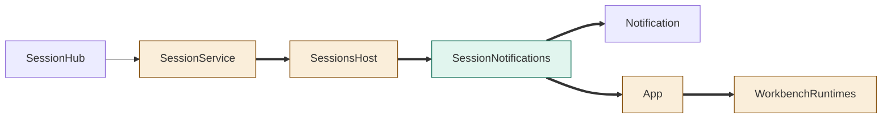
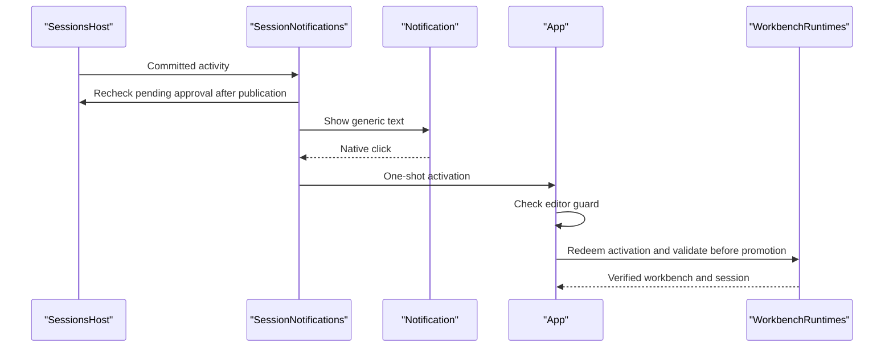
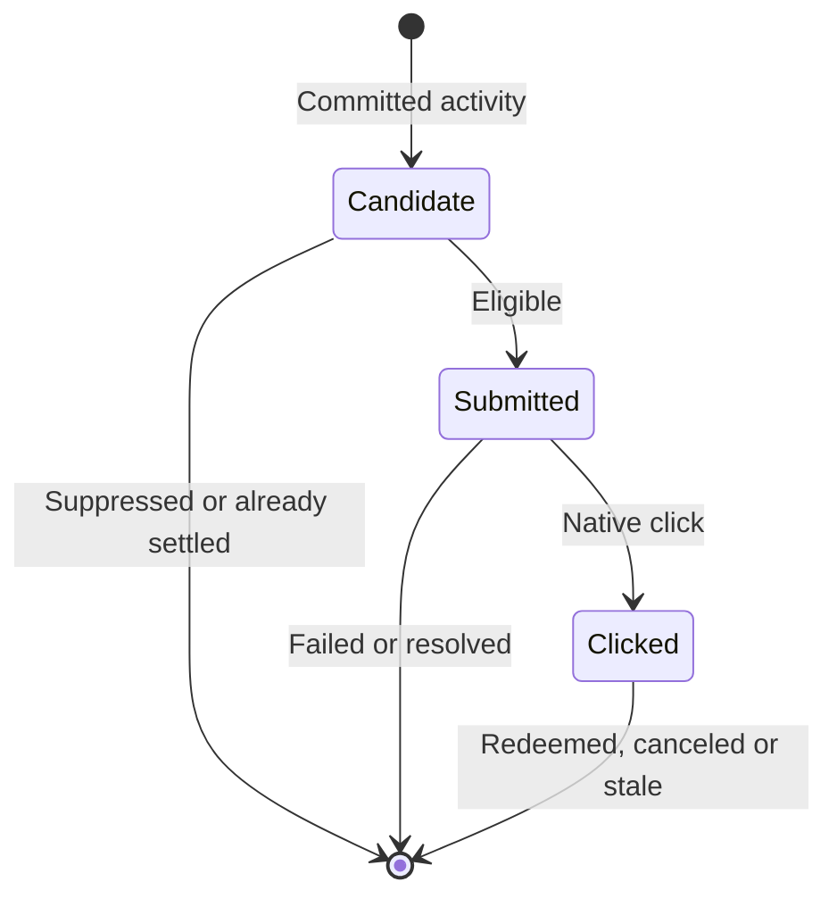

# TASK-be584c0e diagrams

Illustrates the design in TASK-be584c0e.md.

## Structure

SessionService, SessionsHost, App and WorkbenchRuntimes are changed. SessionNotifications is added. SessionHub and Electron Notification are reused.

## Sequence

## State

