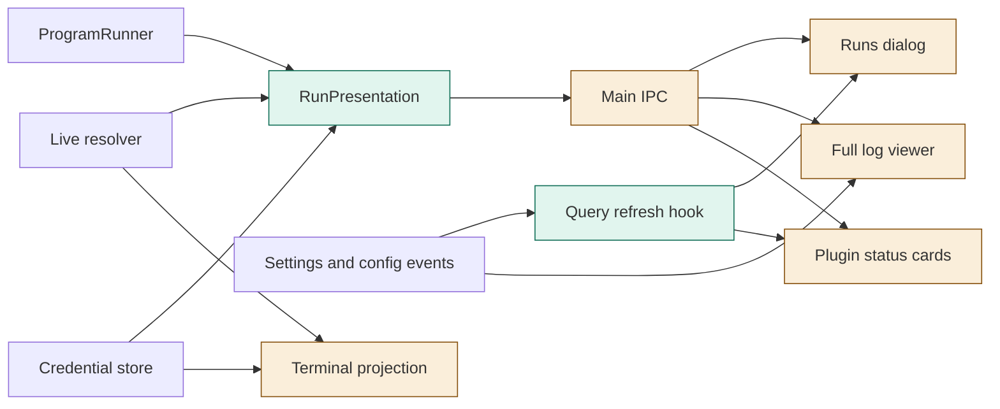
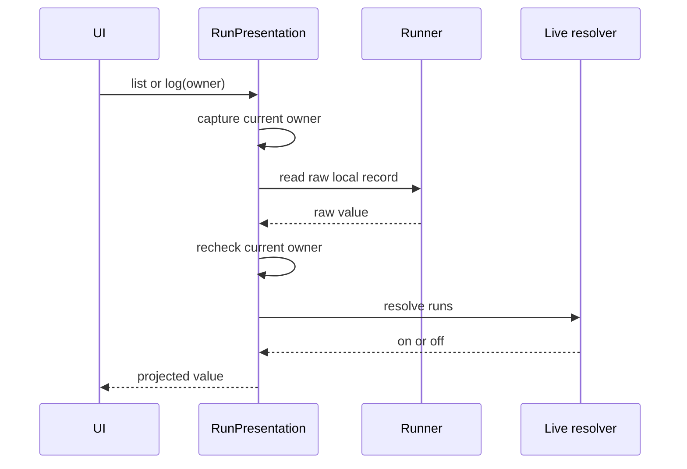

# TASK-bea71615 diagrams

Illustrates Design in TASK-bea71615.md. The Design text is authoritative.

## Structure

Map: RunPresentation and refresh hook added; main composition, terminal projection, Runs dialog, plugin status publication and viewer refresh changed; resolver, credential store and runner reused unchanged.

## Sequence

## State

Not drawn: no lifecycle, status field or state transition changes.
