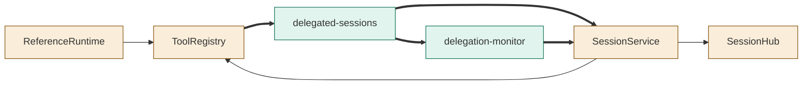
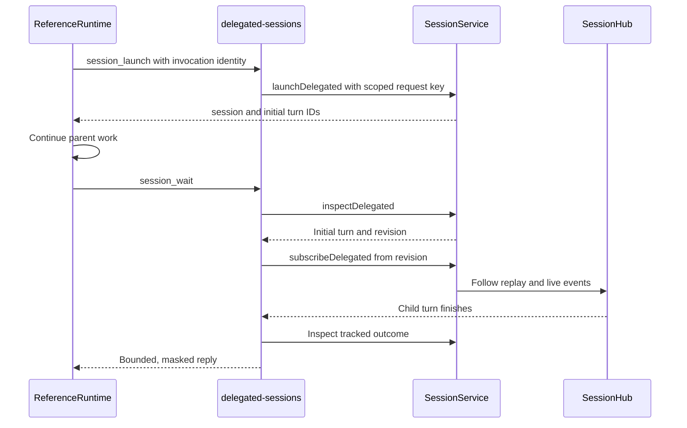
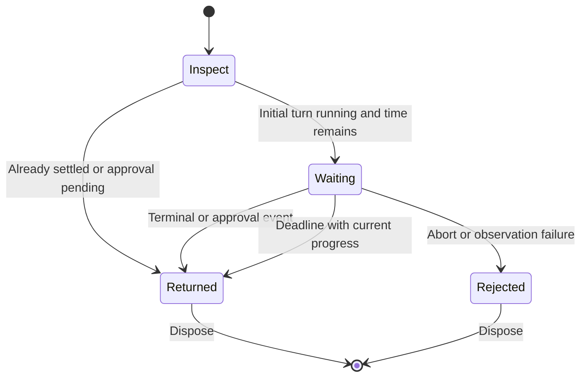

# TASK-c10c09fe diagrams

Illustrates `## Design` in `TASK-c10c09fe.md`. The Design text is authoritative.

## Structure

Added nodes are delegated-sessions and delegation-monitor. Changed nodes are ReferenceRuntime, ToolRegistry, SessionService and SessionHub.

## Sequence

## State

