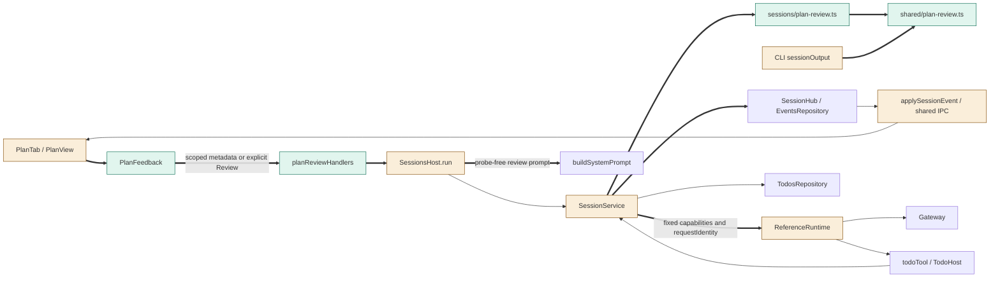

# TASK-c33386cb diagrams

Illustrates `## Design` in `TASK-c33386cb.md`. The Design text is authoritative.
The draft protocol spec `../specs/REQ-DATA-fa8543aa.md` expands D1-D6.

## Structure

Explicit node classification from Design (a new call does not classify its existing callee):

| Node | Class | Explicit edit or reuse |
|---|---|---|
| PlanTab | changed | D6 live row action slots and retained feedback presentation |
| PlanFeedback | added | D6 compact indicators, native editor, re-anchor and review history |
| session_state | changed | D2 shared events/snapshot reducer and strict IPC contracts |
| planReviewHandlers | added | D3 scoped user-only IPC handlers |
| SessionsHost | changed | D3/D5 captured scope, probe-free purposes and ordinary-send preflight |
| SessionService | changed | D2-D5 metadata, atomic review admission and restricted turn setup |
| core_review | added | D1/D4/D5 pure anchor/envelope/receipt and instruction helpers |
| shared_review | added | D1/D2 shared target schemas, exact projection and typed content mapper |
| ReferenceRuntime | changed | D4 optional preallocated requestIdentity; ordinary loop unchanged |
| sessionOutput | changed | D2 typed nested CLI event masking; no new CLI command |
| SessionHub | reused, no class | Existing event repository, folding and post-commit publish |
| todoTool | reused, no class | Existing validated session-class tool, no execution or grant capability |
| TodosRepository | reused, no class | Existing canonical whole-list replacement transaction |
| Gateway | reused, no class | Existing provider/summary transport through restricted service wrapper |
| buildSystemPrompt | reused, no class | Existing canonical builder, called without execution capabilities |

No node is removed. Edges are classified separately: `==>` is a new review/feedback
flow or call; `-->` is an existing call/data flow retained unchanged. Omitted renderer
or sanitizer plumbing is named in Design, not implicitly classified as unchanged here.



## Sequence

Primary path includes draft persistence, one durable admission and structured revision.
Failures before commit retain drafts; a receipt lookup after commit never starts a second turn.

```mermaid
sequenceDiagram
    participant UI as PlanFeedback
    participant Main as planReviewHandlers
    participant Host as SessionsHost
    participant Core as SessionService
    participant DB as SessionHub / SQLite
    participant Runtime as ReferenceRuntime
    participant Model as Gateway
    UI->>Main: Save draft(scope, expectedFeedbackRevision, exact target, text)
    Main->>Host: metadata purpose with expected workbenchId
    Host->>Core: Validate captured DB, writable session, target and feedback CAS
    Core->>DB: Commit plan.comments.saved only
    DB-->>UI: Post-commit shared session event; no transcript/model request
    UI->>Main: Review(scope, expectedPlanRevision, expectedFeedbackRevision)
    Main->>Host: review purpose; never probe programs or prepare execution hosts
    Host->>Core: reviewPlan in captured workbench/service
    Core->>DB: Find scoped accepted receipt for the expected counter pair
    alt Original pair already accepted
        DB-->>Core: Original reviewId / turnId / messageId
        Core-->>UI: Same receipt; no request, mutation or dispatch
    else Fresh pair
        Core->>Core: Validate plan, all pending targets, CAS, idle/queue/approval/lifecycle guards
        Core->>Runtime: Construct restricted runtime and preallocated requestIdentity; do not send
        Core->>DB: One transaction: submitted envelope, user row/event, turn.started, running status
        alt Transaction fails
            DB-->>Core: Roll back every seed record
            Core-->>UI: Visible error; pending feedback unchanged
        else Transaction commits
            Core->>Core: Install active kind=plan-review
            Core->>Runtime: send(captured revision-only request)
            Runtime-->>Core: Matching initial identity echoes suppressed, not persisted twice
            Core-->>UI: Publish committed seed events and receipt
            Runtime->>Model: Only built-in todo offered; every dispatch crosses ownership barrier
            Model-->>Runtime: Response may contain todo or chat only
            opt Validated structured todo returned
                Runtime->>Core: TodoHost replacement with no execution/approval host
                Core->>DB: Existing todo + todo.updated transaction
                DB-->>UI: Live revised plan; old pending anchors become stale
            end
            Model-->>Runtime: Brief explanation or clarification in ordinary chat
            Runtime-->>Core: turn.done
            Core->>DB: Persist final outcome; retain immutable review history
            DB-->>UI: Shared transcript/history updates
        end
    end
```

## State

This is the feedback workflow focus, not ownership transfer of historical records.
Every accepted envelope remains immutable in history when a retry creates new drafts.

```mermaid
stateDiagram-v2
    [*] --> PendingFresh: Explicit Save draft on current validated target
    PendingFresh --> PendingFresh: Edit text / add / delete another draft, feedback CAS
    PendingFresh --> PendingStale: todo.updated or invalidated exact projection
    PendingStale --> PendingStale: Edit text, preserve original target and quote
    PendingStale --> PendingFresh: Explicit re-anchor all stale drafts
    PendingFresh --> NoPending: Delete last draft
    PendingStale --> NoPending: Remove last draft
    NoPending --> PendingFresh: Save a new draft
    PendingFresh --> Submitting: Explicit Review plan, UI ref guards duplicates
    Submitting --> PendingFresh: Preacceptance failure, original drafts retained
    Submitting --> PendingStale: Revision/projection conflict, drafts retained
    Submitting --> AcceptedRunning: Atomic seed commit, captured drafts submitted
    AcceptedRunning --> AcceptedRunning: Duplicate/lost-ack pair returns same receipt
    AcceptedRunning --> AcceptedComplete: turn.done end
    AcceptedRunning --> AcceptedUnsuccessful: error / limit / Stop / recovery aborted
    AcceptedComplete --> PendingFresh: New explicit feedback on current plan
    AcceptedUnsuccessful --> RetryStaged: Explicit restore copies feedback; no model dispatch
    RetryStaged --> PendingStale: Original targets no longer validate
    RetryStaged --> PendingFresh: Current targets still validate
    note right of AcceptedRunning
        Chat, review metadata and validated todo only.
        Ordinary send is BUSY through finalization.
        No probes, programs, file edits or grants.
    end note
    note right of AcceptedUnsuccessful
        Submitted history survives restart.
        Restore never resends ordinary chat.
        Only later Review can dispatch a new turn.
    end note
```


