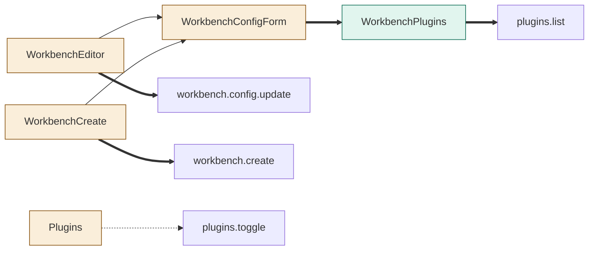
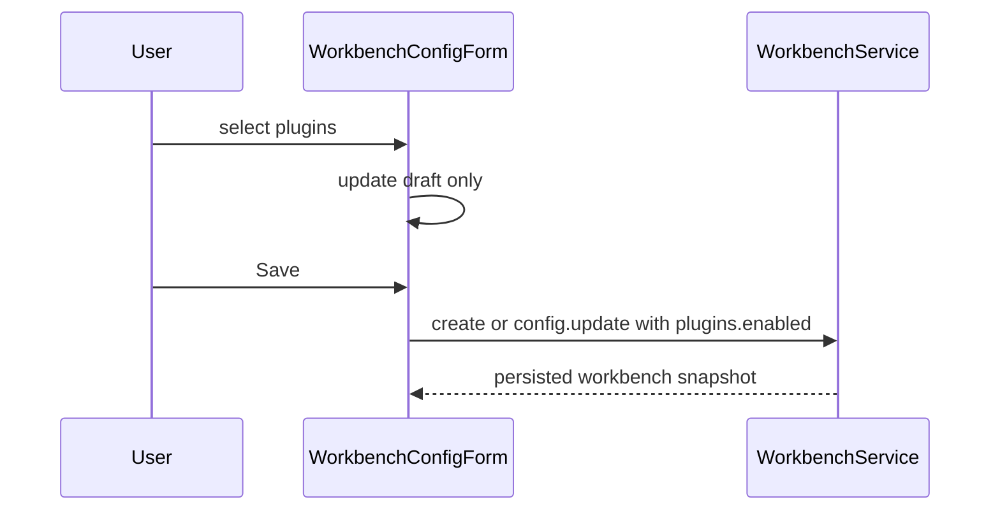
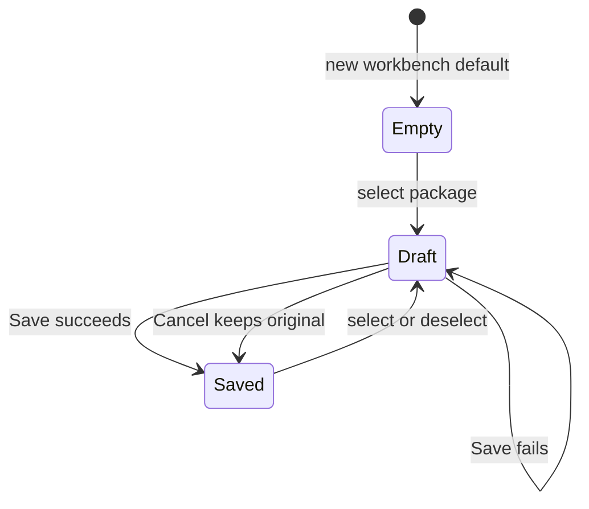

# TASK-c6ce11a7 diagrams
Illustrates Design; Design is authoritative.

## Structure
Added: WorkbenchPlugins. Changed: WorkbenchConfigForm, WorkbenchEditor, WorkbenchCreate, Plugins. Unchanged: IPC/service/store.

## Sequence

## State

