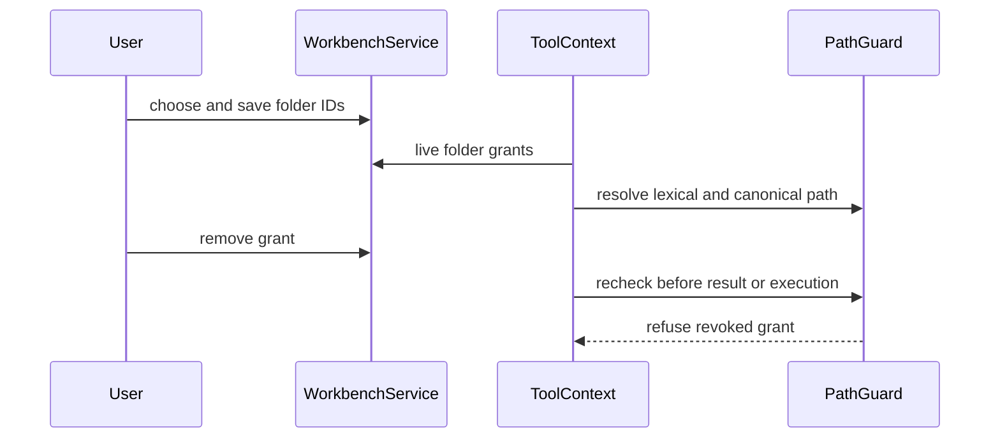
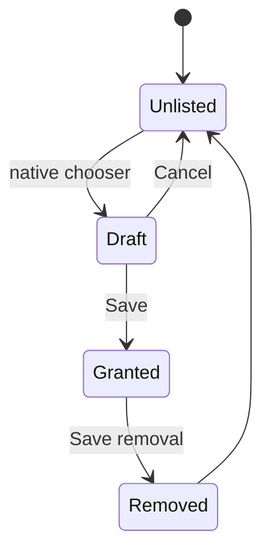

# TASK-c819e1fd diagrams

Illustrates Design in TASK-c819e1fd.md. Design is authoritative.

## Structure
Map: WorkbenchFolders added; WorkbenchService, ToolContext and PathGuard changed; ApprovalGate reused.

## Sequence

## State

