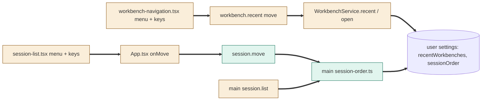
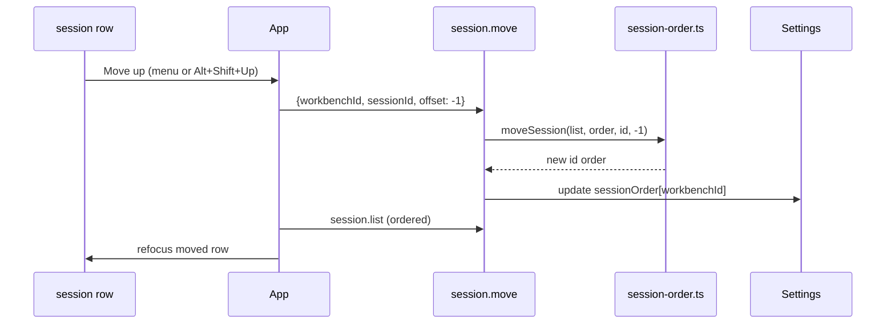

# TASK-c99ca08c diagrams

Illustrates `## Design` in `TASK-c99ca08c.md`. The Design text is authoritative.

Node classes (from the Design):

| Node | Class |
|---|---|
| main session-order.ts, session.move channel | added |
| WorkbenchService.recent/open, shared settings/ipc, main session.list, workbench-navigation, session-list, App | changed |
| settings service, sessions host | unchanged (reused) |

## Structure

## Sequence

## State

Not drawn: orders are plain lists without a lifecycle.
