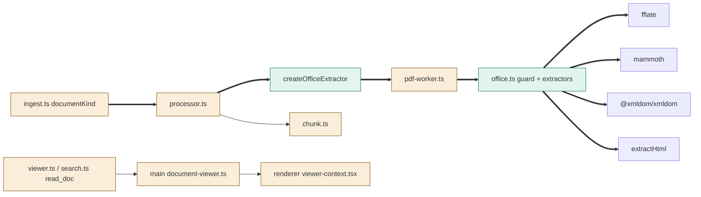
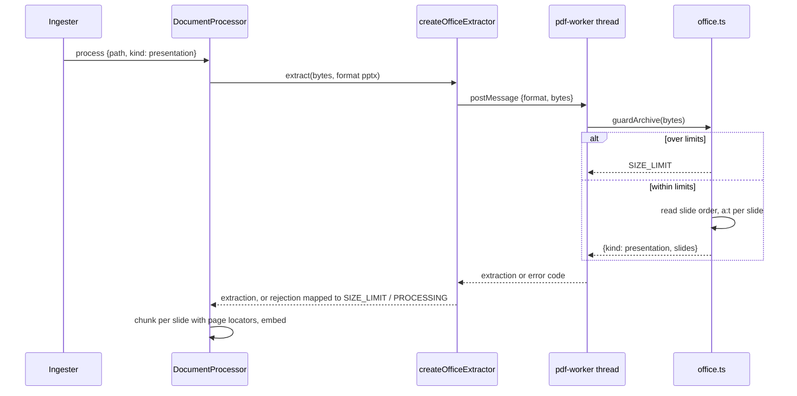

# TASK-ca6e05a5 diagrams

Illustrates `## Design` in `TASK-ca6e05a5.md`. The Design text is authoritative.

Node classes (from the Design):

| Node | Class |
|---|---|
| knowledge/office.ts (archive guard + extractors) | added |
| createOfficeExtractor | added |
| shared documents.ts schemas, extraction.ts, pdf-worker.ts, processor.ts, ingest.ts documentKind, chunk.ts, search.ts, viewer.ts, documents-scan.ts, workbench/service.ts ref bounds | changed |
| main document-viewer.ts, renderer viewer-context.tsx | changed |
| extractHtml, mammoth, fflate, @xmldom/xmldom | unchanged (reused / dependency) |

## Structure

## Sequence

## State

Not drawn: document statuses (pending, indexed, failed) are unchanged; this task only adds failure reasons on existing transitions.
