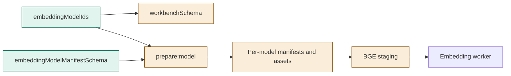
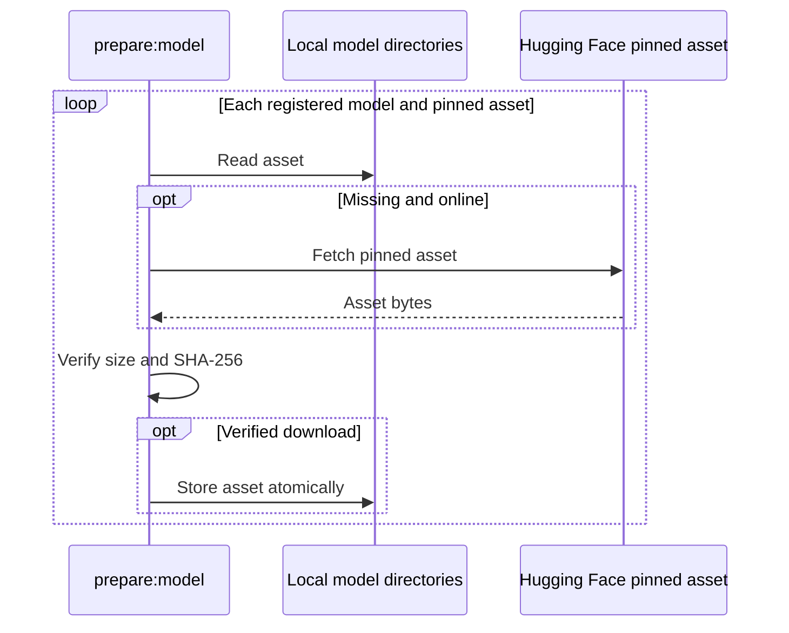

# TASK-cf154b82 diagrams

Illustrates the Design in [TASK-cf154b82.md](TASK-cf154b82.md).

## Structure

Added: embedding-model registry and shared manifest schema. Changed: workbench schema, preparation, BGE manifest location and staging. Reused: embedding worker.

## Sequence

## State

Not drawn: the task adds no lifecycle states.
