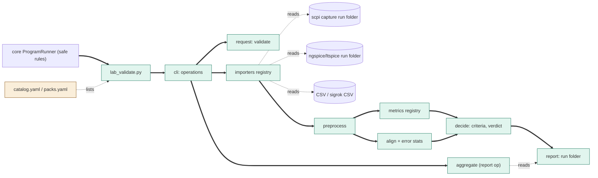
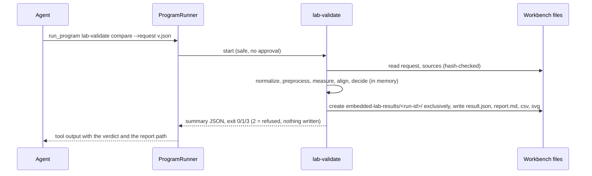
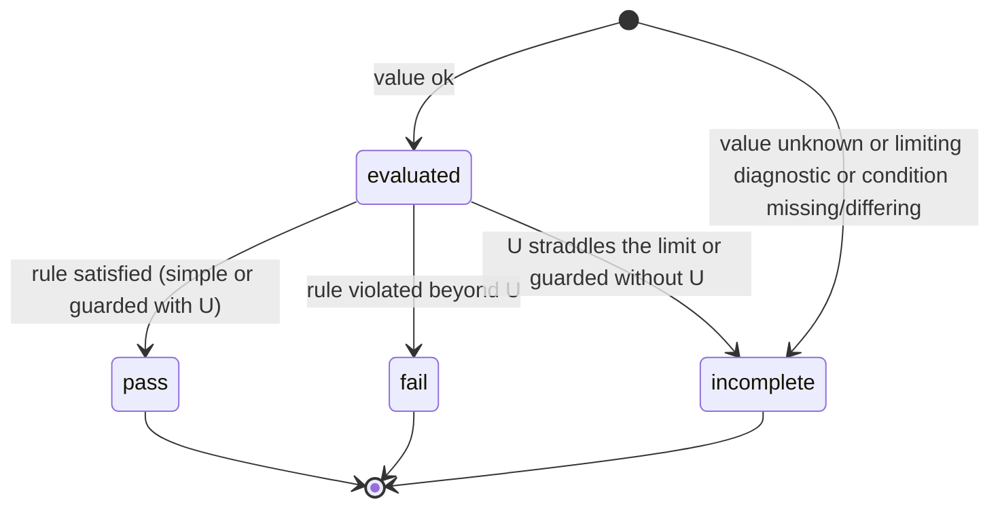

# TASK-cf769025 diagrams

Illustrates `## Design` in `TASK-cf769025.md`. The Design text is authoritative.

Node map: added - lab_validate.py, cli, request, importers, preprocess, metrics, align, decide, report, aggregate
; changed - catalog.yaml and packs.yaml (new entries); unchanged - runner, scpi capture folder, ngspice/ltspice run folder, CSV file.

## Structure

## Sequence

## State

