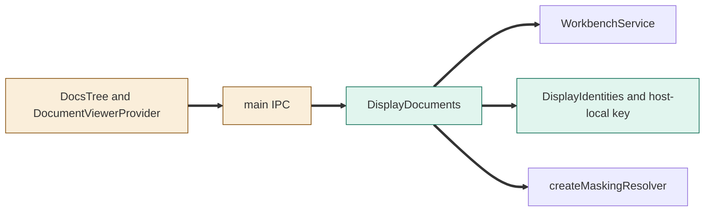
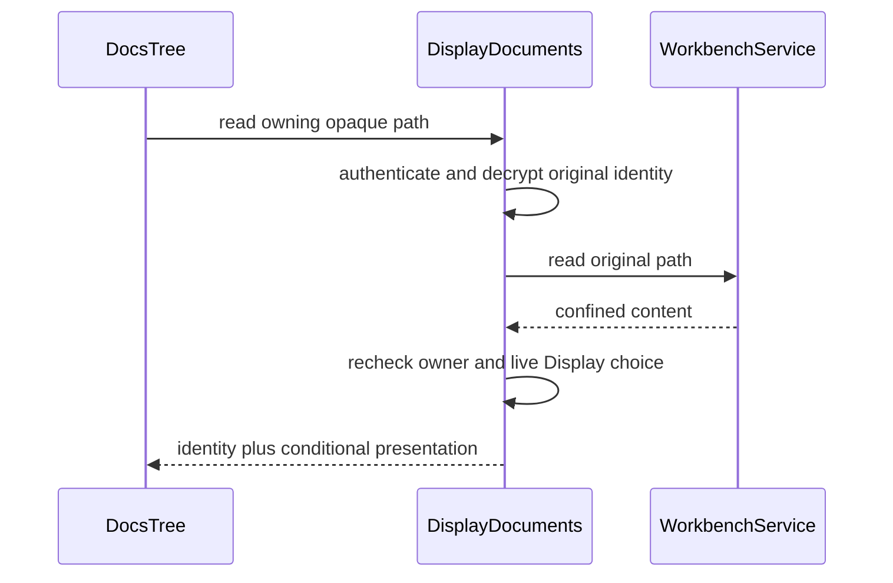

# TASK-cfee41bb diagrams

Illustrates the journal Design. Node map: DisplayDocuments and DisplayIdentities added; main IPC and renderer changed; WorkbenchService/resolver reused.

## Structure

## Sequence

## State

```mermaid
stateDiagram-v2
 [*] --> Owned: workbench listing
 Owned --> Owned: issue or resolve exact identity
 Owned --> Closed: workbench closes; pending reads invalidated
 Closed --> Owned: reopen with persistent key
 Closed --> [*]
```

