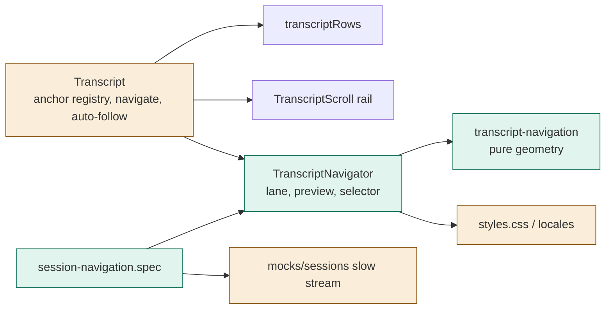
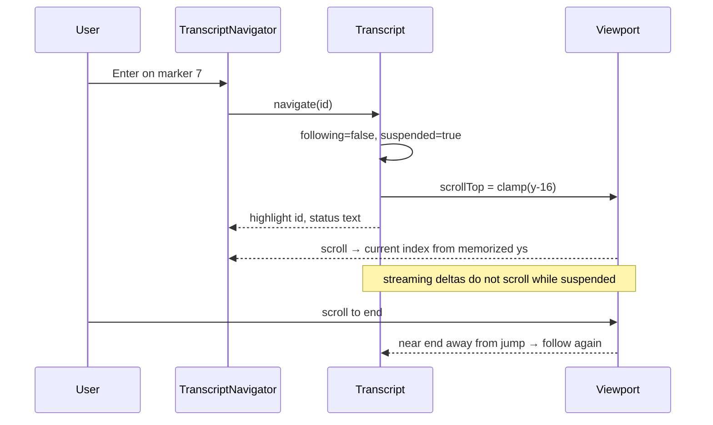
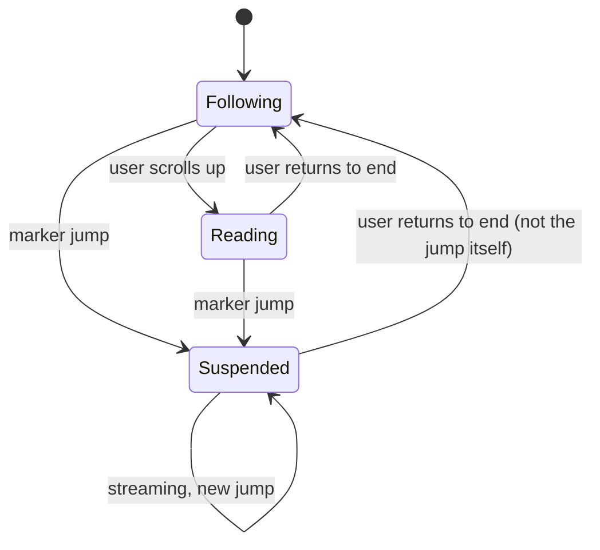

# TASK-d0a44d9c diagrams

Illustrates `## Design` in `TASK-d0a44d9c.md`. The Design text is authoritative.

Node map: added = transcript-navigation helper, TranscriptNavigator, navigation spec; changed = Transcript (registry,
navigate, suspension), styles, locales, mock sessions; unchanged = TranscriptScroll rail, transcriptRows.

## Structure

## Sequence

## State

