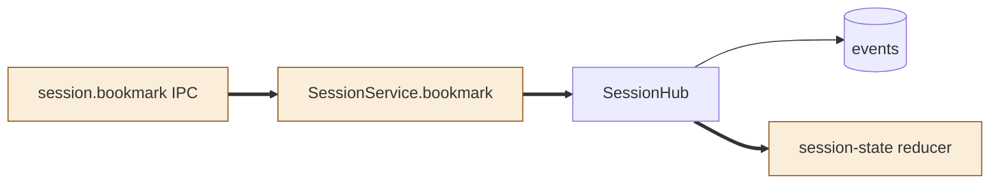
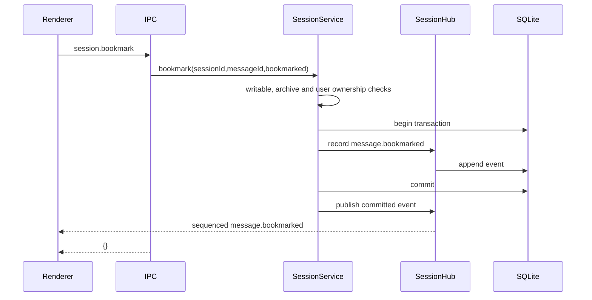
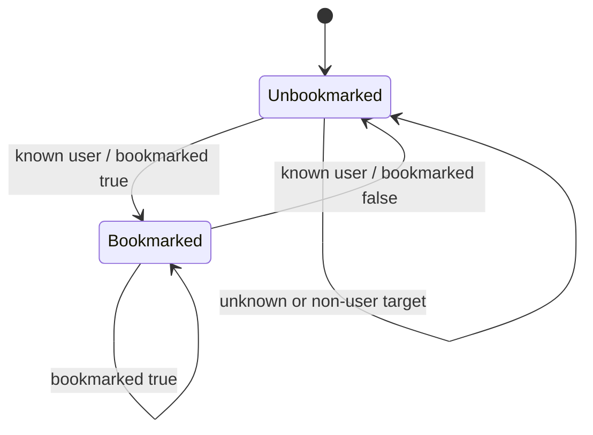

# TASK-d20f7557 diagrams

Illustrates the authoritative Design in TASK-d20f7557.md.

## Structure

Node map: IPC, SessionService and reducer changed; SessionHub, events store and agent reused unchanged.

## Sequence

## State

