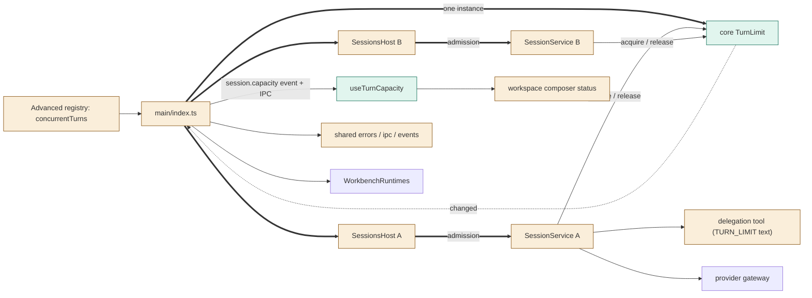
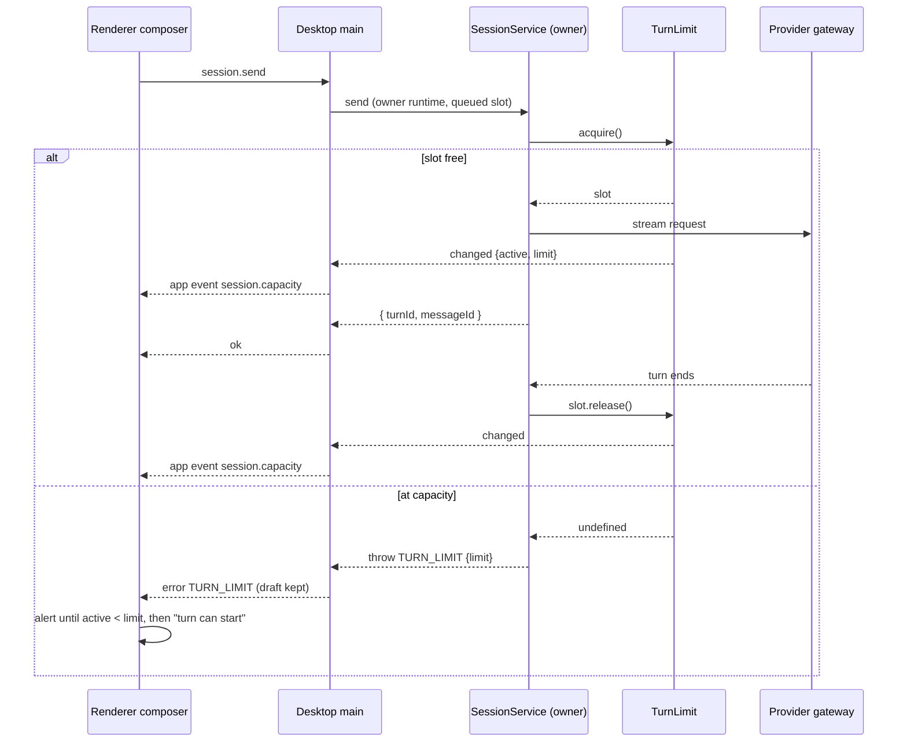
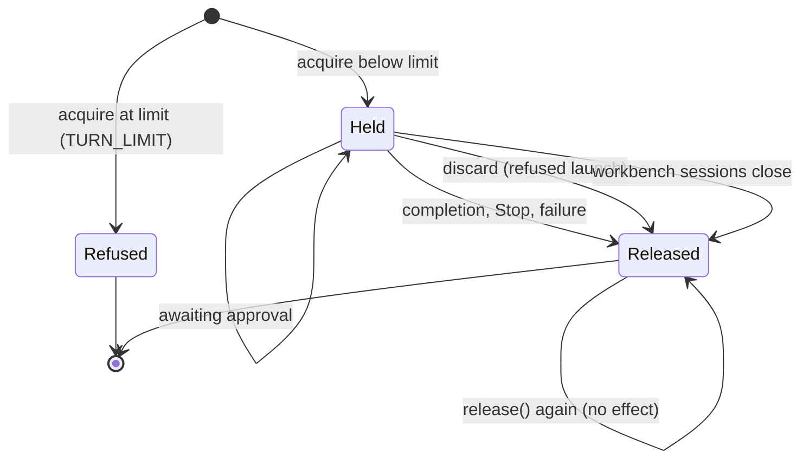

# TASK-d3a3049f diagrams

Illustrates `## Design` in `TASK-d3a3049f.md`. The Design text is authoritative.

Node classes: TurnLimit (core admission) and useTurnCapacity = added; Advanced registry, shared
errors/IPC/events, SessionService, delegation tool, main index.ts, SessionsHost, renderer workspace and
mock = changed; ReplayGateway/provider gateway and WorkbenchRuntimes = unchanged.

## Structure

## Sequence

## State

