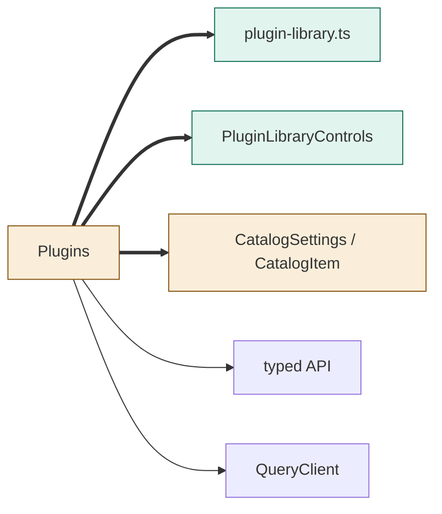
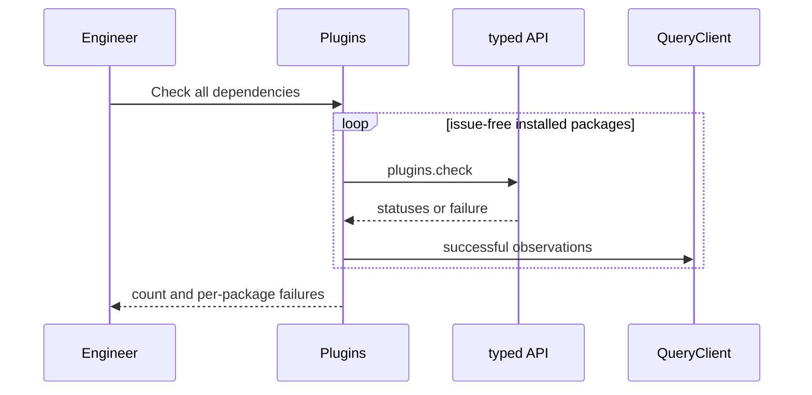
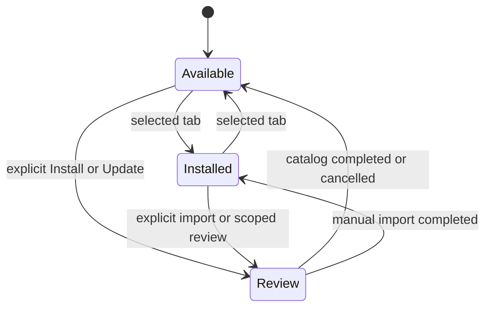

# TASK-d5791e9a diagrams

Illustrates journal Design; the journal is authoritative.
Map: Plugins and CatalogSection changed; library model/controls added; API/QueryClient reused unchanged.

## Structure

## Sequence

## State

