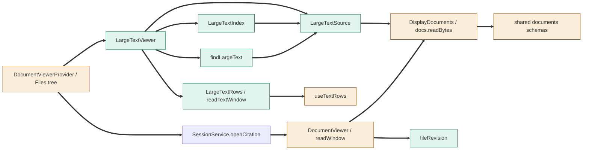
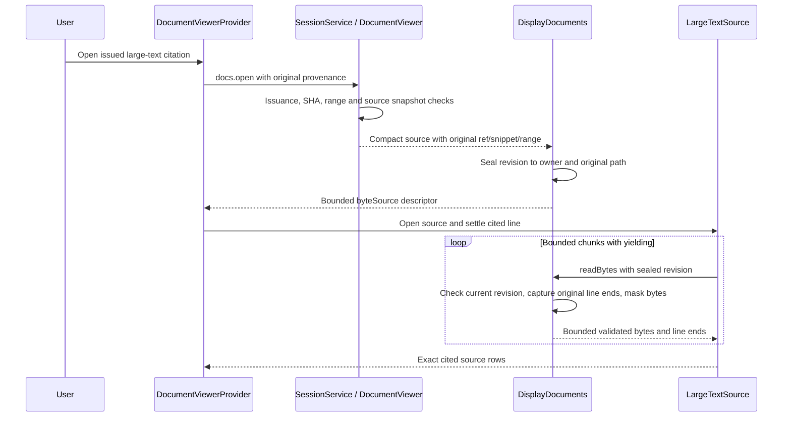
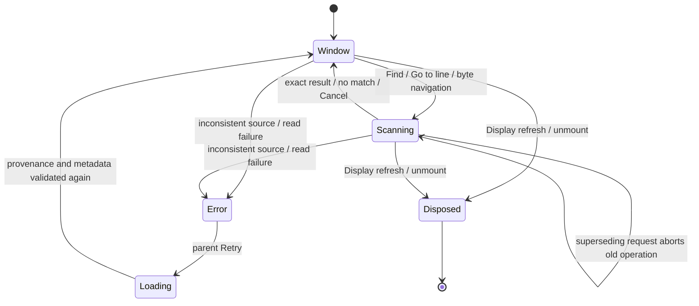

# TASK-d6ed6549 diagrams

Illustrates the authoritative task Design.

## Structure

Map: provider/tree/useTextRows/core viewer/readWindow/readBytes/Display/schema changed;
large source/index/find/window/rows/viewer and fileRevision added. Session verification is reused.

## Sequence

## State

