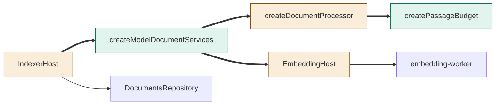
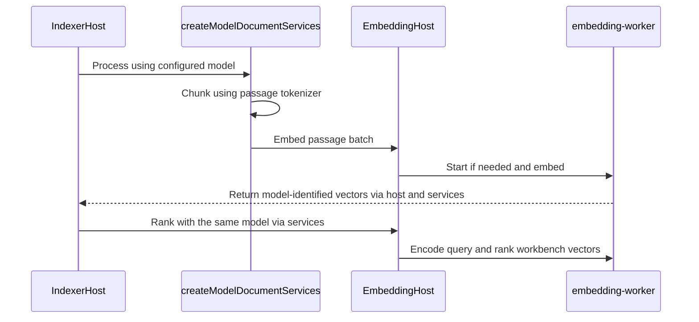
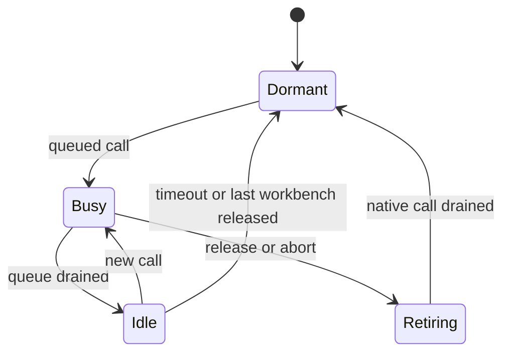

# TASK-d73ff73d diagrams

Illustrates the Design in TASK-d73ff73d.md.

## Structure

Changed nodes are IndexerHost, EmbeddingHost and createDocumentProcessor. Added nodes are createModelDocumentServices and createPassageBudget. embedding-worker and DocumentsRepository are reused for inference and writes.

## Sequence

## State

