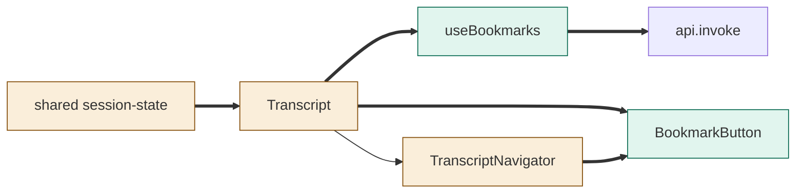
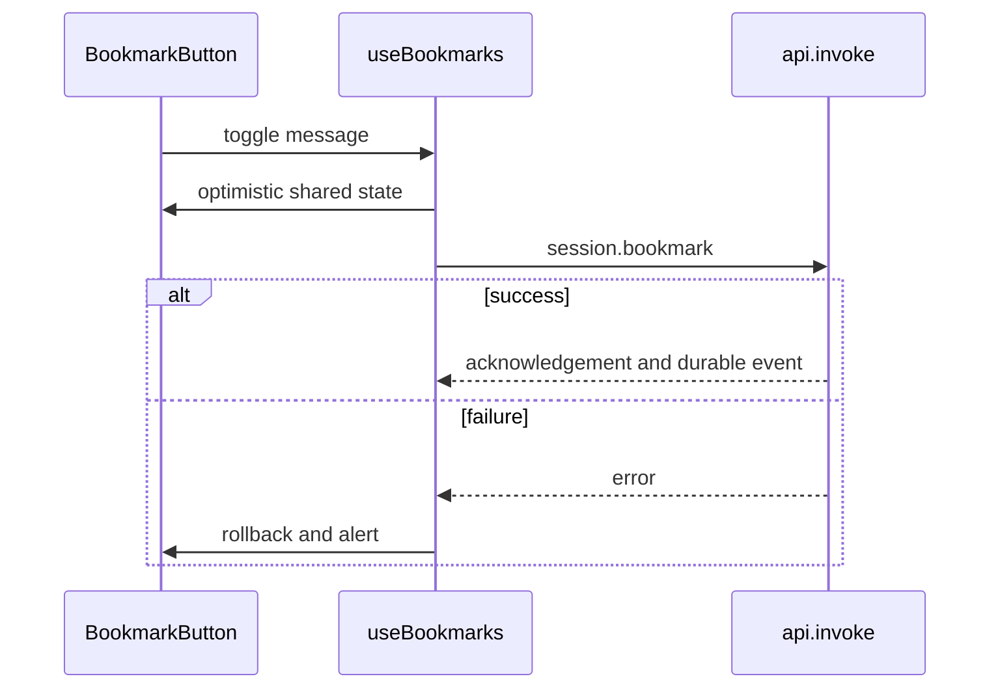
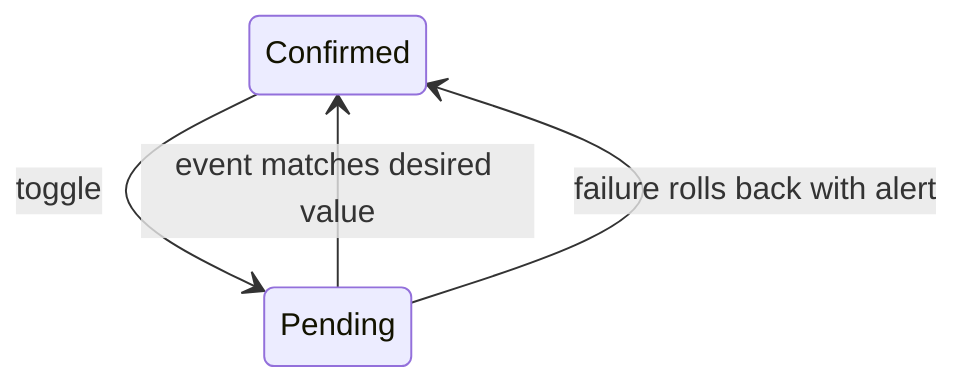

# TASK-d798dbc7 diagrams

Illustrates the journal Design, which is authoritative.

## Structure
Node map: Transcript, TranscriptNavigator and shared session-state changed; useBookmarks and BookmarkButton added; api.invoke reused.

## Sequence

## State

