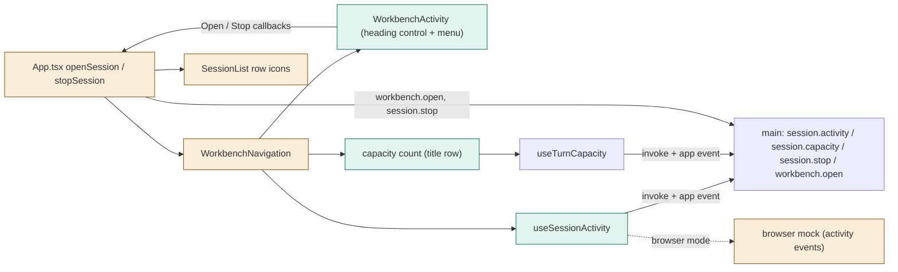
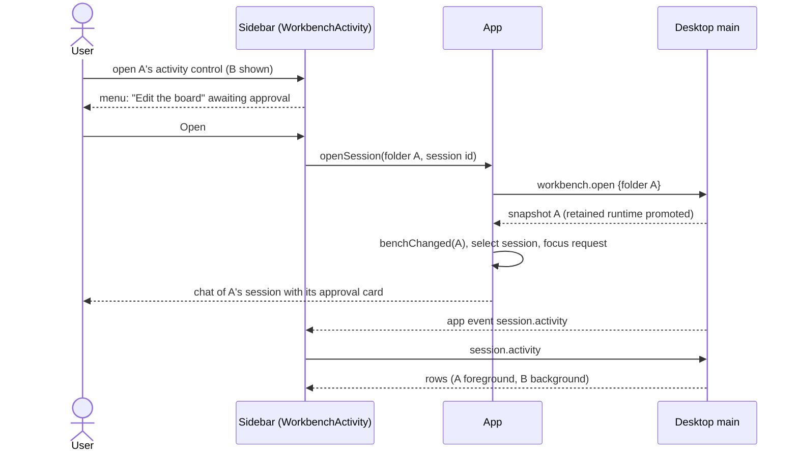
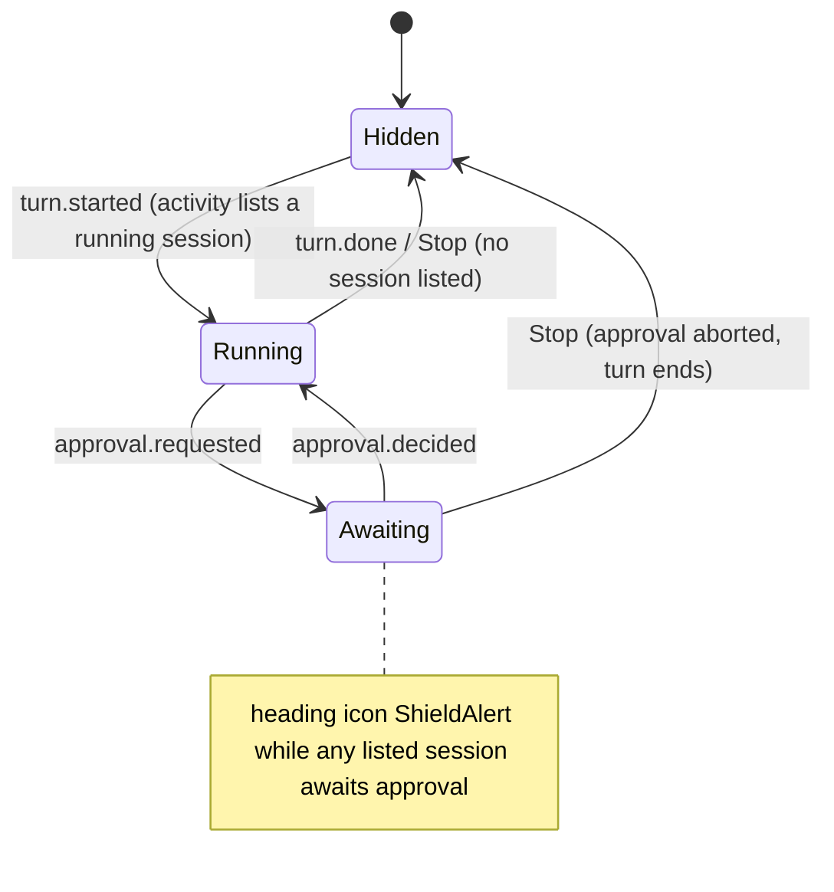

# TASK-da9a680b diagrams

Illustrates `## Design` in `TASK-da9a680b.md`. The Design text is authoritative.

Node classes from the Design: added = useSessionActivity, WorkbenchActivity, capacity count;
changed = WorkbenchNavigation, SessionList, App, browser mock; unchanged = main session.activity,
session.capacity, session.stop, workbench.open, useTurnCapacity, SessionWorkspace composer alert (text only).

## Structure

## Sequence

## State

