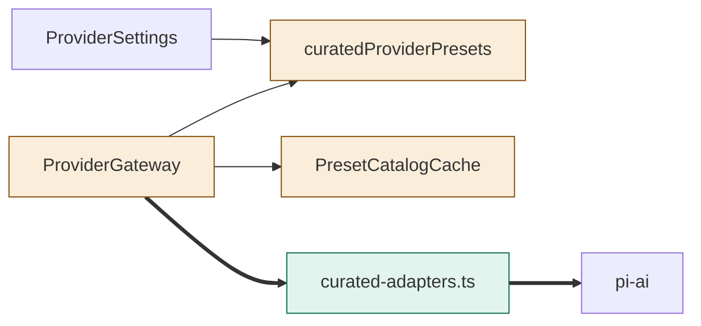
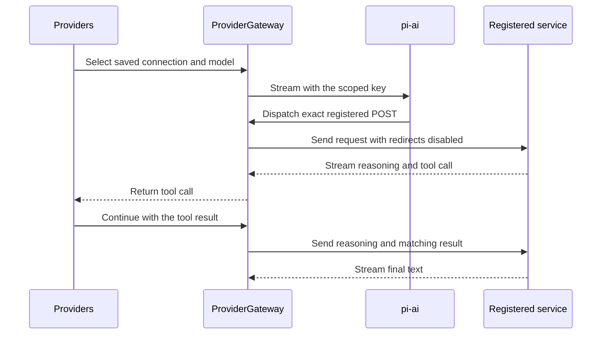

# TASK-db834e2a diagrams

## Structure

Changed nodes are the curated registry, ProviderGateway and its catalog cache. The curated adapter module is new.

## Sequence

## State

Not drawn: this feature uses the existing provider operation lifecycle.
