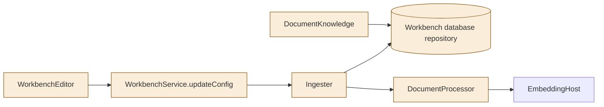
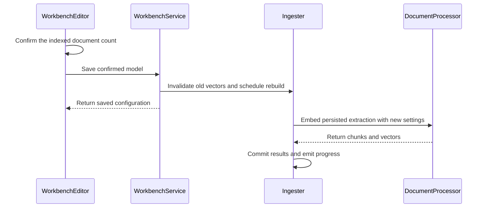
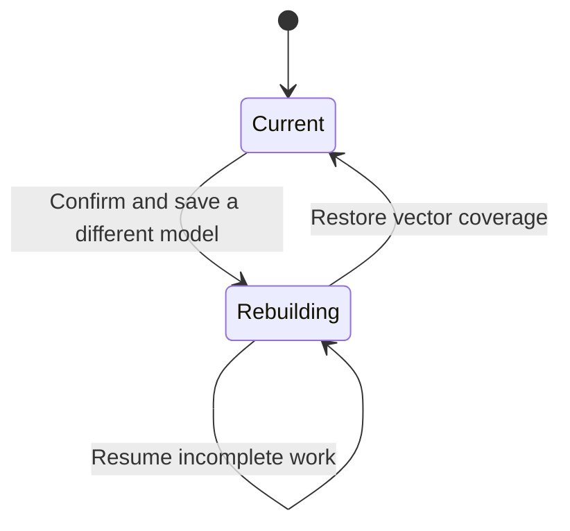

# TASK-dd7b8f09 diagrams

Illustrates the Design in [TASK-dd7b8f09.md](TASK-dd7b8f09.md).

## Structure

Changed components include the editor, configuration service, ingester, SQLite repository, processor and document search. The embedding worker retains its existing interface.

## Sequence

## State

