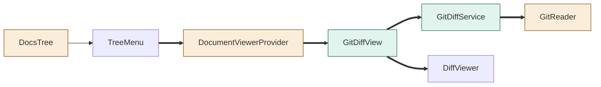
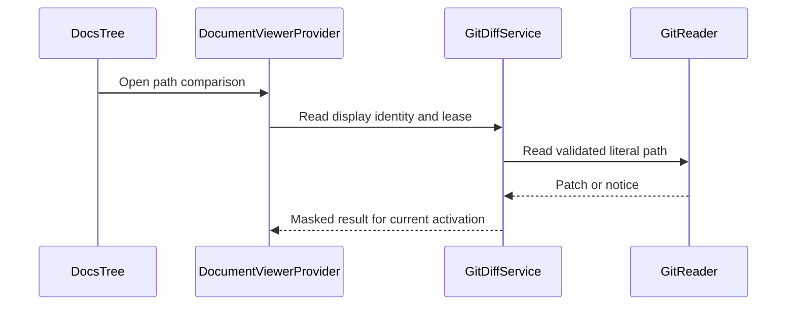
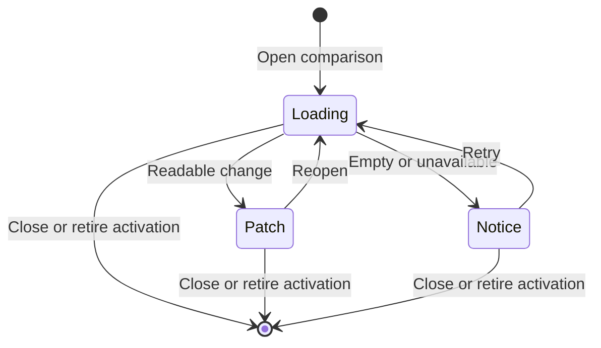

# TASK-de5a9991 diagrams

Illustrates the task journal's Design.

## Structure

Added: GitDiffService, GitDiffView. Changed: DocsTree, DocumentViewerProvider, GitReader. Reused: TreeMenu, DiffViewer.

## Sequence

## State

