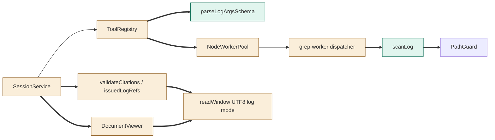
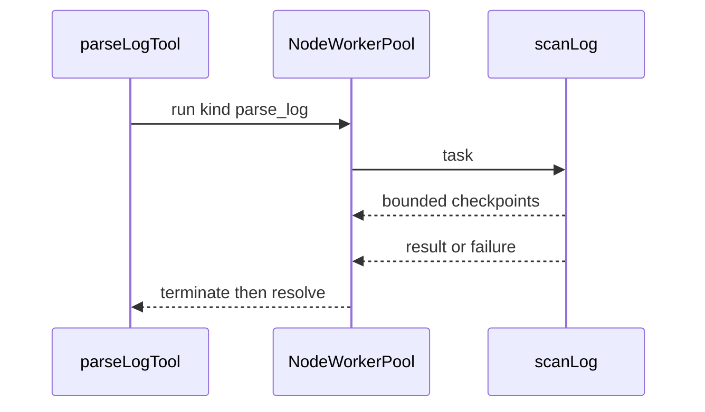
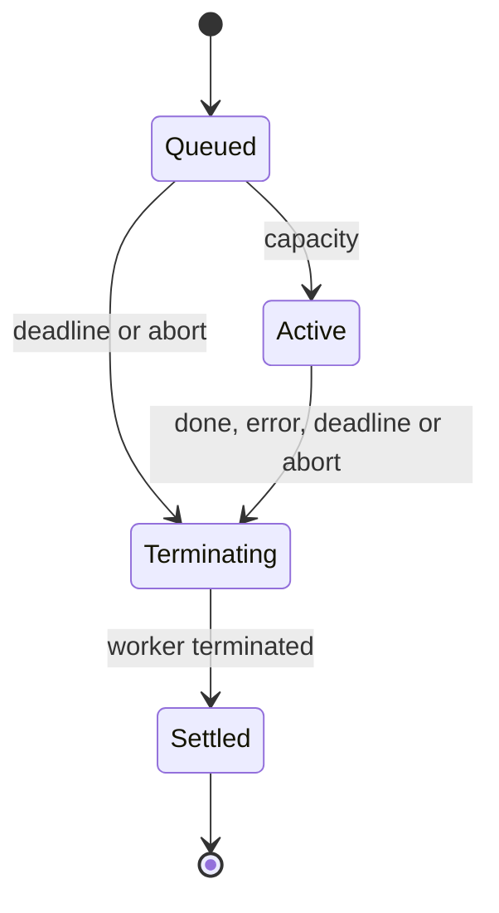

# TASK-e08bb421 diagrams
Illustrates Design in TASK-e08bb421.md.
## Structure
Map: registry/worker entry/NodeWorkerPool changed; scanner/schema added; PathGuard reused; citation verifier, readWindow, SessionService and DocumentViewer changed.

## Sequence

## State

