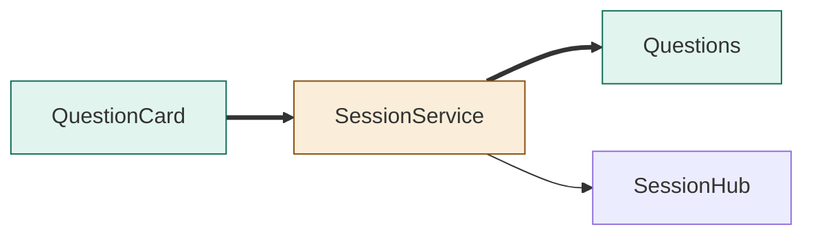
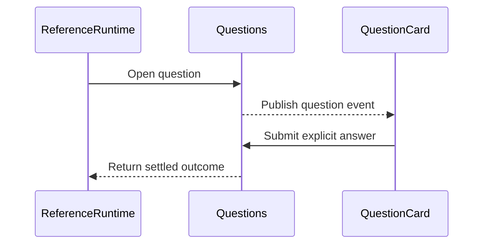
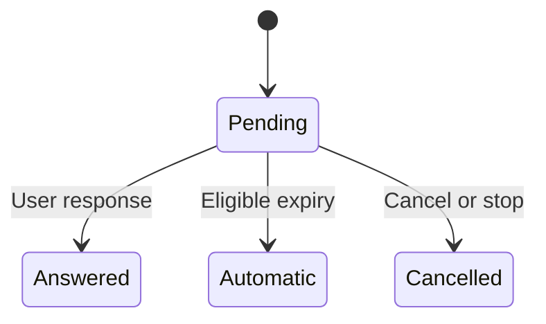

# TASK-e4a93d3b diagrams

Illustrates the Design in TASK-e4a93d3b.md.

## Structure

Added nodes: QuestionCard, Questions. Changed nodes: SessionService. Unchanged nodes: SessionHub.

## Sequence

## State

