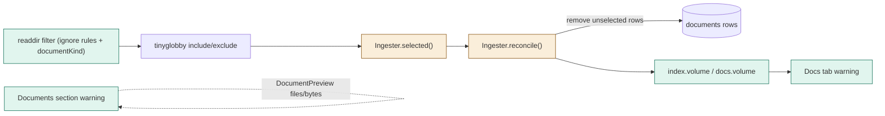
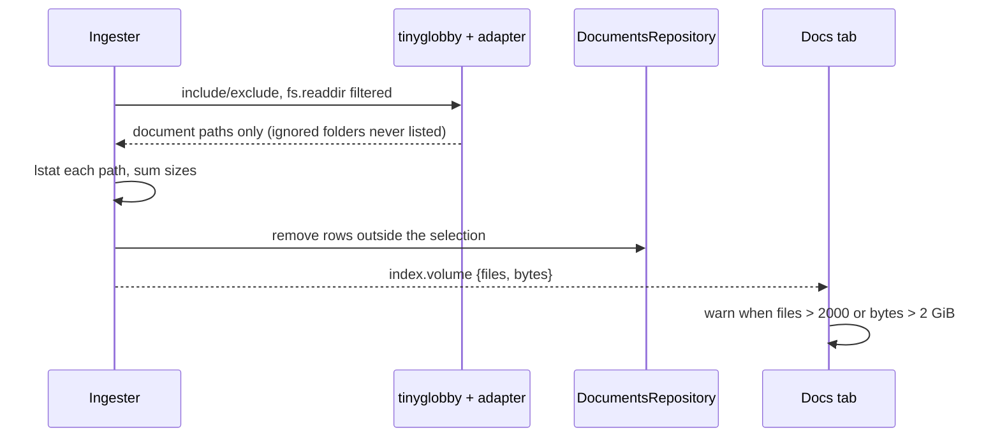

# TASK-e5310cdb diagrams

Illustrates `## Design` in `TASK-e5310cdb.md`. The Design text is authoritative.

| Node | Class |
|---|---|
| readdir filter adapter, index.volume event, docs.volume channel, volume warning | added |
| documentKind, Ingester.selected/reconcile, WorkbenchService, docs-tab, workbench-documents | changed |
| tinyglobby, DocumentsRepository, processor | unchanged (reused) |

## Structure

## Sequence

## State

Not drawn: the volume is a value replaced at each selection.
