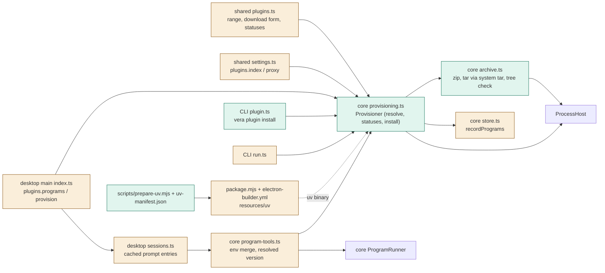
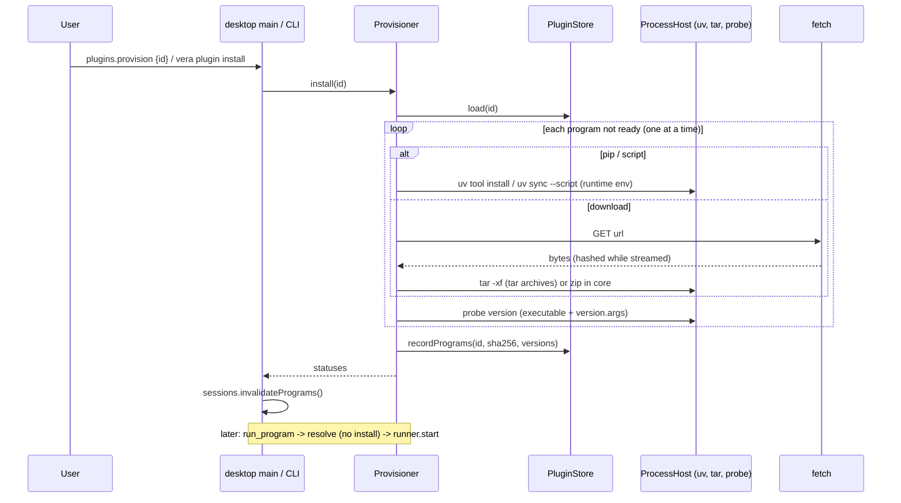
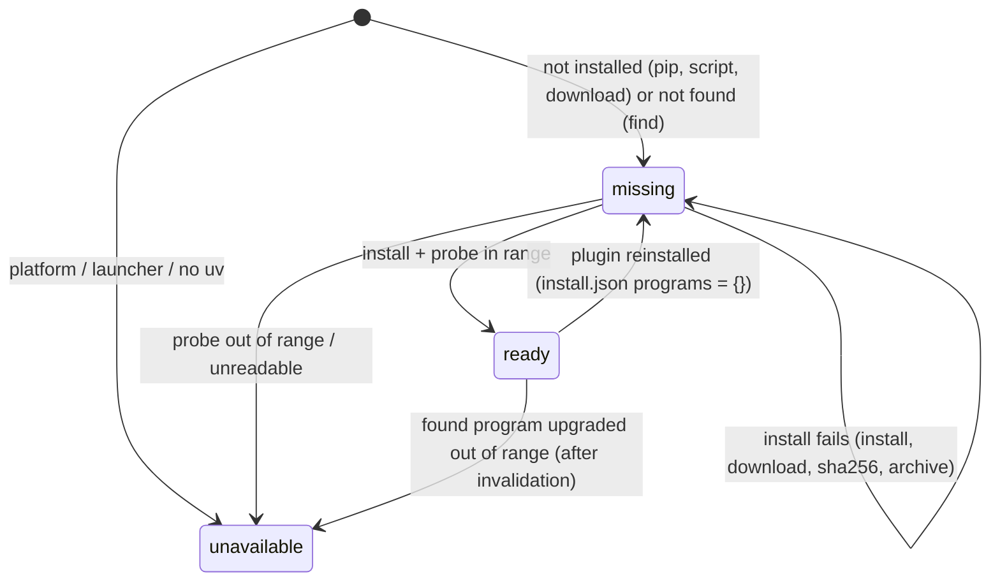

# TASK-e68d92ee diagrams

Illustrates `## Design` in `TASK-e68d92ee.md`. The Design text is authoritative.

Node classes: added = provisioning.ts, archive.ts, prepare-uv.mjs, uv-manifest.json, CLI plugin.ts,
IPC plugins.programs/provision; changed = shared plugins.ts schema, settings.ts, store.ts
(recordPrograms), program-tools.ts (env, version), desktop main index.ts, sessions.ts (cache), CLI
run.ts, package.mjs, electron-builder.yml; unchanged = runner, NodeProcessHost, approvals.

## Structure

## Sequence

## State

