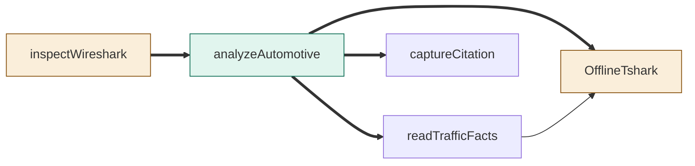
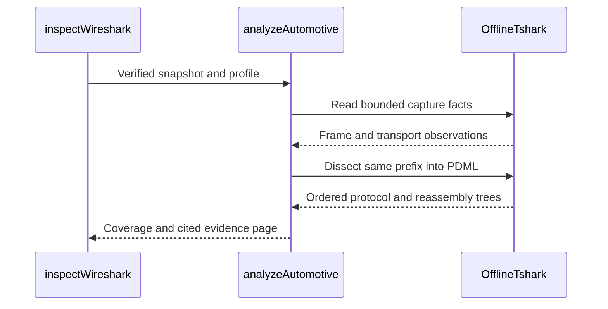

# TASK-ea176ded diagrams

Illustrates the design in `TASK-ea176ded.md`.

## Structure

Changed nodes: `inspectWireshark`, `OfflineTshark`. Added node: `analyzeAutomotive`.
Reused nodes: `readTrafficFacts`, `captureCitation`.

## Sequence

## State

Not drawn: evidence describes the saved capture and has no application lifecycle.
