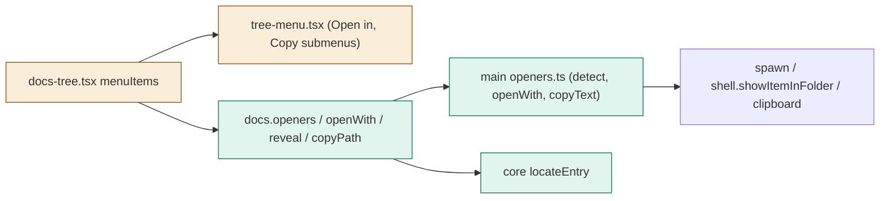
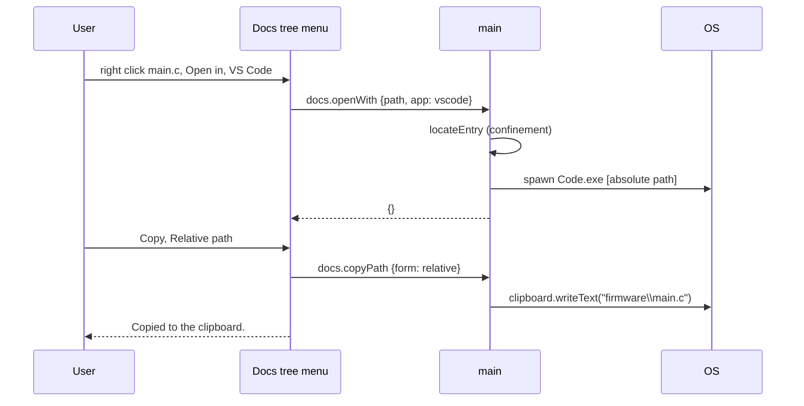

# TASK-eae3a69e diagrams

Illustrates `## Design` in `TASK-eae3a69e.md`. The Design text is authoritative.

| Node | Class |
|---|---|
| main openers.ts, docs.openers/openWith/reveal/copyPath, core locateEntry | added |
| tree-menu.tsx (submenus), docs-tree.tsx menu, mockApi | changed |
| app.openPath (Default app), app.info, PathGuard | unchanged (reused) |

## Structure

## Sequence

## State

Not drawn: the menu has at most one open submenu; opening another closes it.
