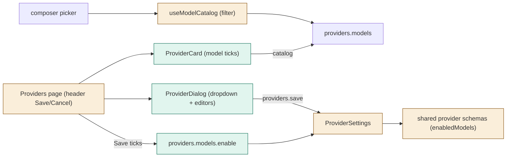
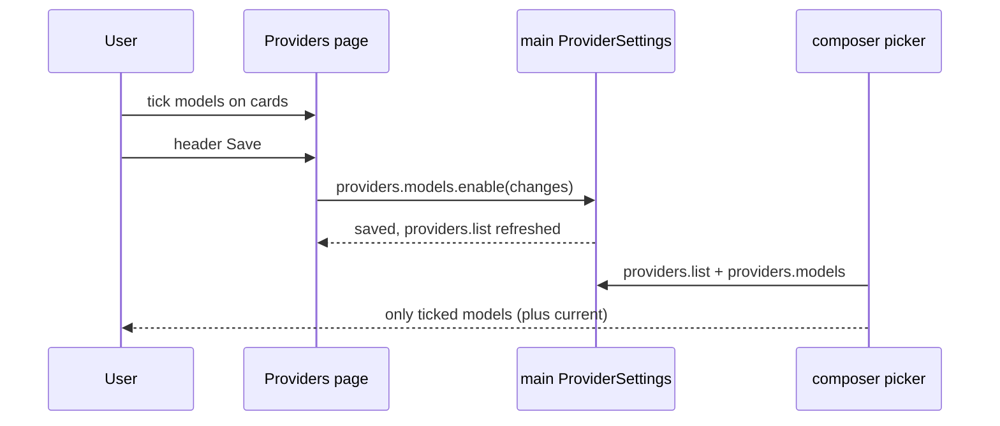

# TASK-ec18086f diagrams

Illustrates `## Design` in `TASK-ec18086f.md`. The Design text is authoritative.

Node classes from the Design: added = providers.models.enable, ProviderCard, ProviderDialog; changed = shared provider
schemas, ProviderSettings, Providers page, useModelCatalog, browser mock; unchanged = providers.models, editors, composer.

## Structure

## Sequence

## State

Not drawn: ticks are a page draft over saved lists; no new lifecycle.
