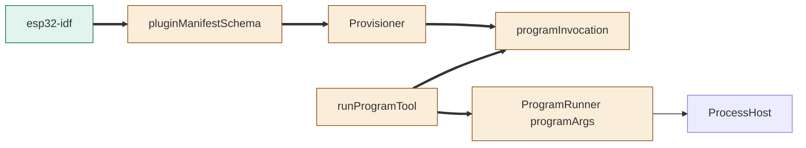
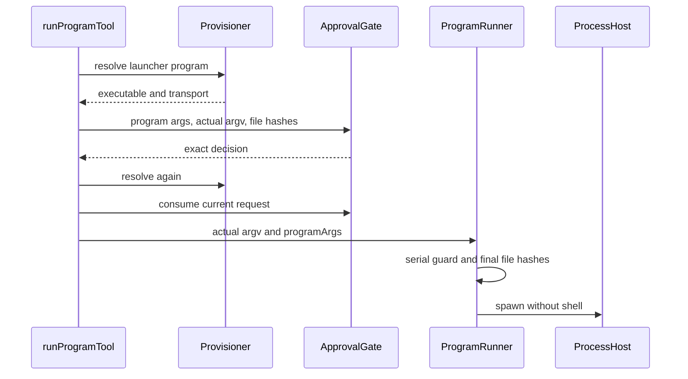

# TASK-f00f64cb diagrams

Illustrates Design in TASK-f00f64cb.md. Design text is authoritative.

## Structure

Node map: schema, Provisioner, launcher helper, tools and runner changed; esp32-idf added; ProcessHost reused unchanged.

## Sequence

## State

Not drawn: reuses existing program provisioning and run lifecycle states.
