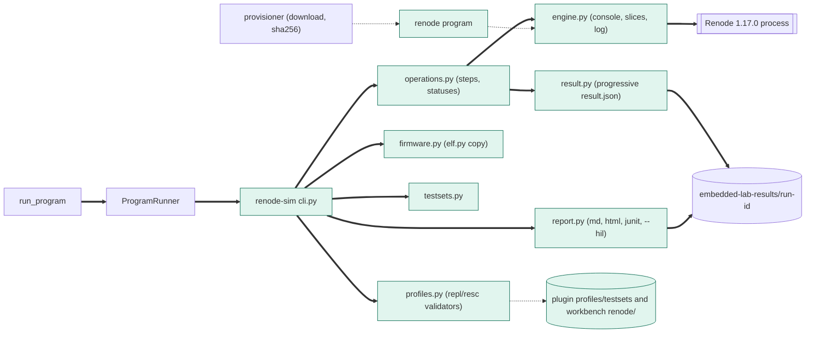
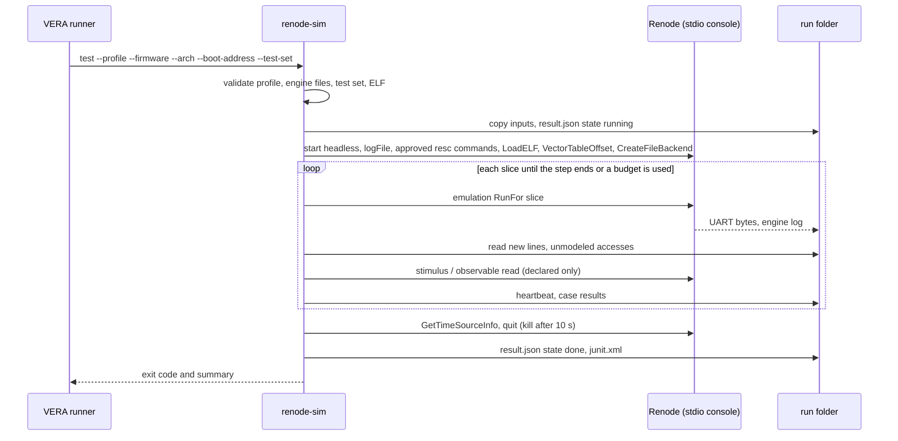
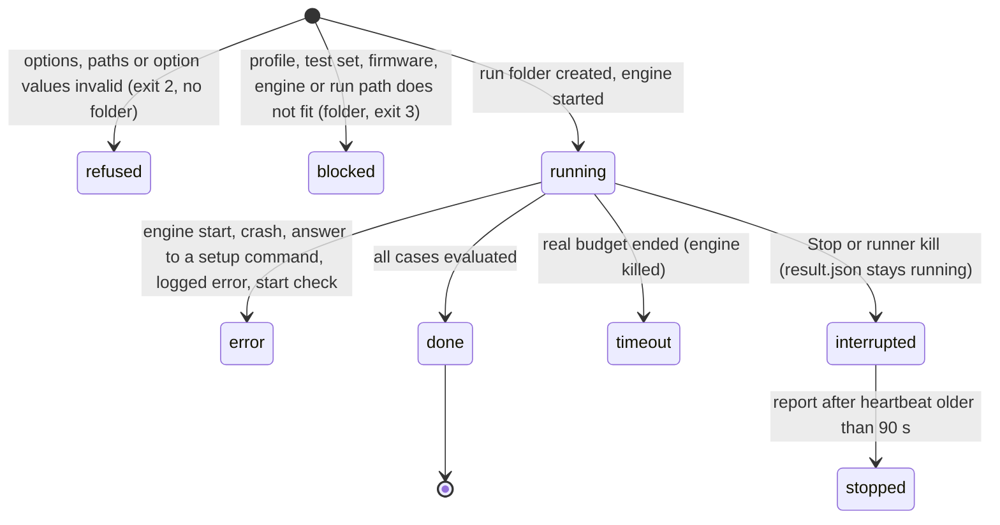

# TASK-f059e085 diagrams

Illustrates `## Design` in `TASK-f059e085.md`. The Design text is authoritative.

Node map: added - renode-sim cli, profiles, firmware, testsets, engine, operations, result, report, renode program,
plugin profiles/test sets; unchanged - VERA runner, run_program, provisioner, workbench files, Renode engine.

## Structure

## Sequence

## State

