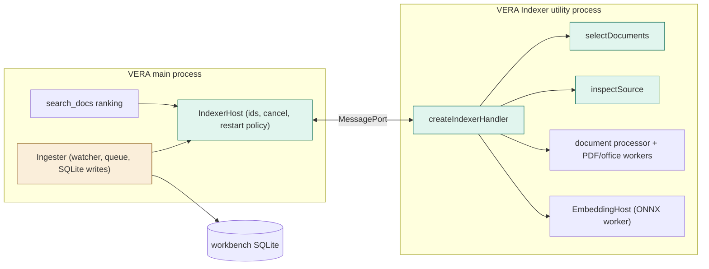
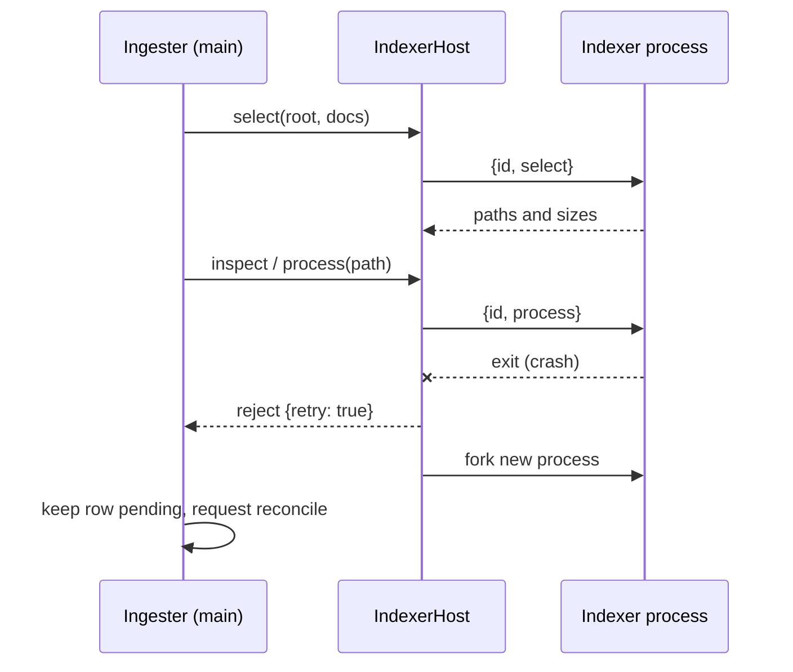
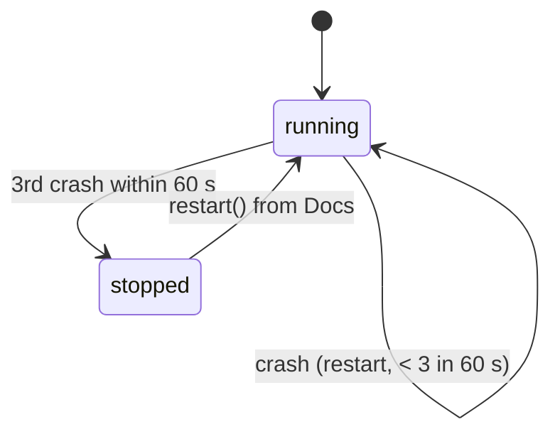

# TASK-f09609fd diagrams

Illustrates `## Design` in `TASK-f09609fd.md`. The Design text is authoritative.

| Node | Class |
|---|---|
| indexer-process, indexer-host, selection.ts, inspect.ts, indexer.status/restart | added |
| Ingester (ports, retry), desktop composition, Docs tab | changed |
| SQLite repositories, watcher, document processor, EmbeddingHost | unchanged (moved behind the protocol) |

## Structure

## Sequence

## State

