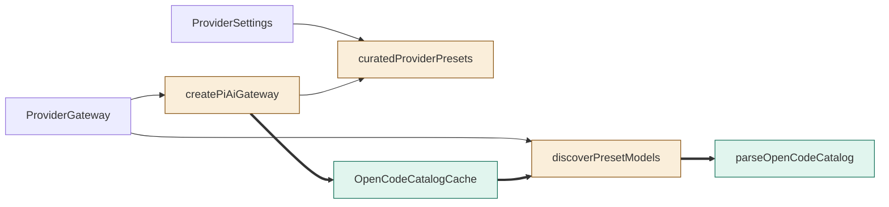
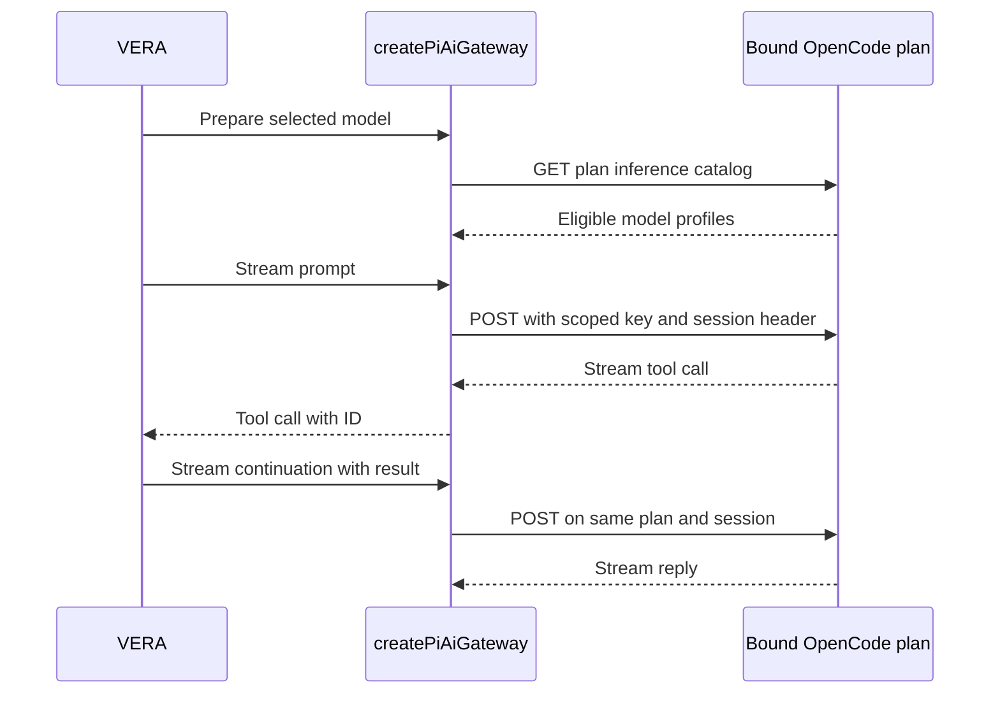

# TASK-f9b010e7 diagrams

Illustrates the task’s Design.

## Structure

Added: OpenCode catalog cache and parser. Changed: registry and preset catalog loader, gateway. Reused: ProviderSettings and ProviderGateway.

## Sequence

## State

Not drawn: existing cancellation and connection states are reused.
