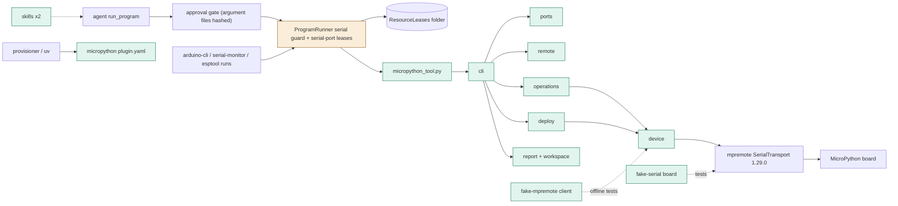
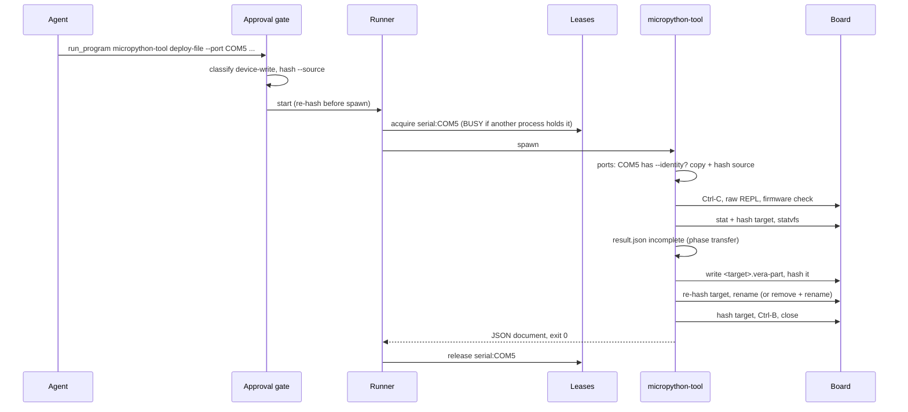
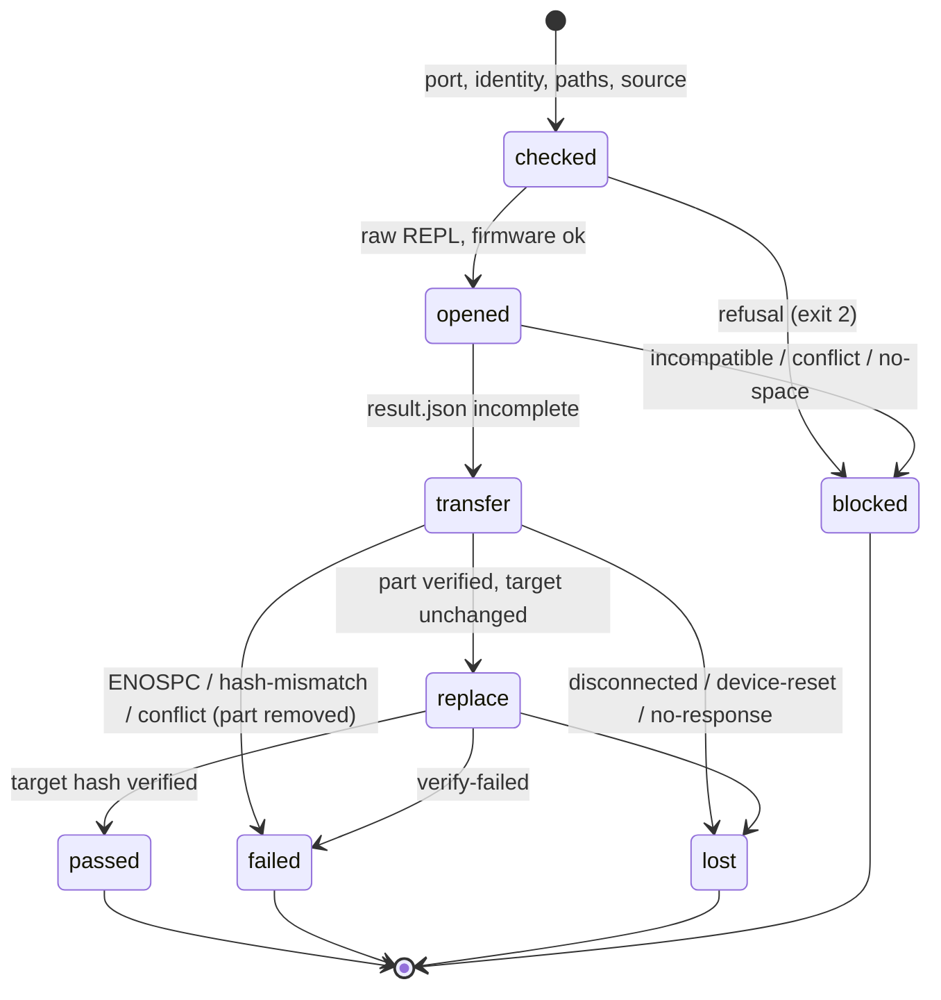

# TASK-fa2b0429 diagrams

Illustrates `## Design` in `TASK-fa2b0429.md`. The Design text is authoritative.

Node map: added - micropython plugin.yaml, micropython_tool.py, cli, ports, remote, device, deploy, operations, report +
workspace, skills, fake-serial board, fake-mpremote client; changed - ProgramRunner (serial-port leases); unchanged -
approval gate, ResourceLeases, provisioner/uv, mpremote 1.29.0, arduino-cli/serial-monitor/esptool packages.

## Structure

## Sequence

## State

