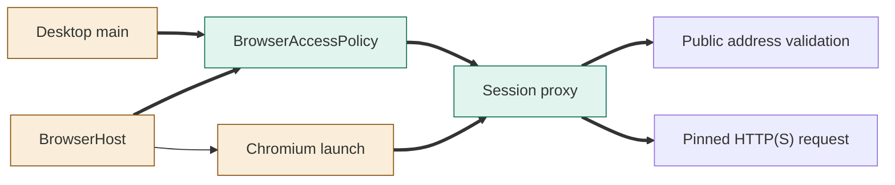
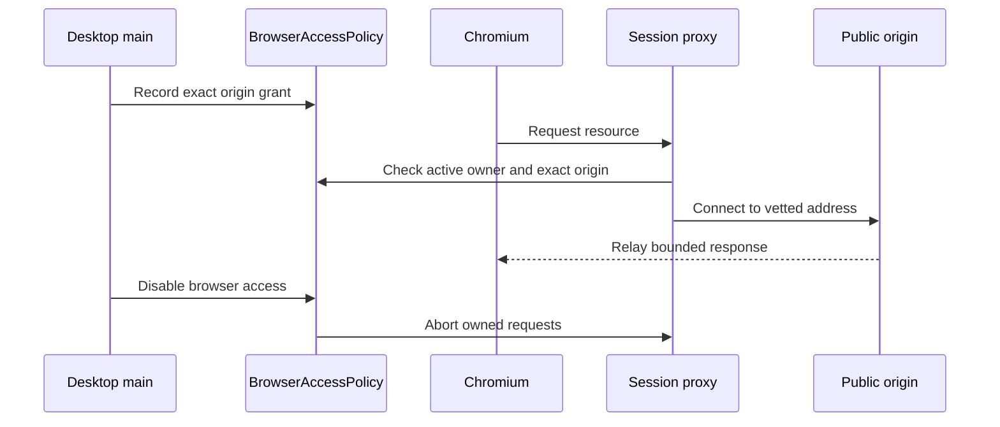
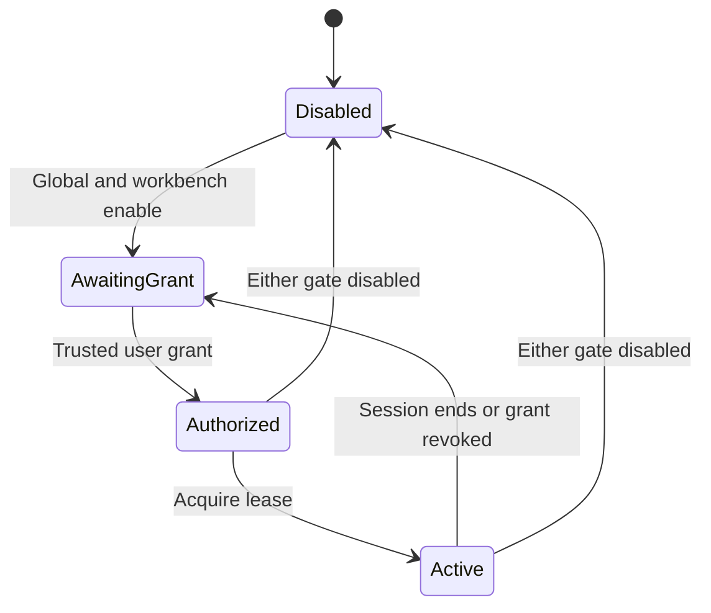

# TASK-fc2d54a9 diagrams

Illustrates the Design section in TASK-fc2d54a9.md.

## Structure

BrowserHost and Chromium launch change. BrowserAccessPolicy and the scoped proxy are added. Public address validation is reused.

## Sequence

## State

