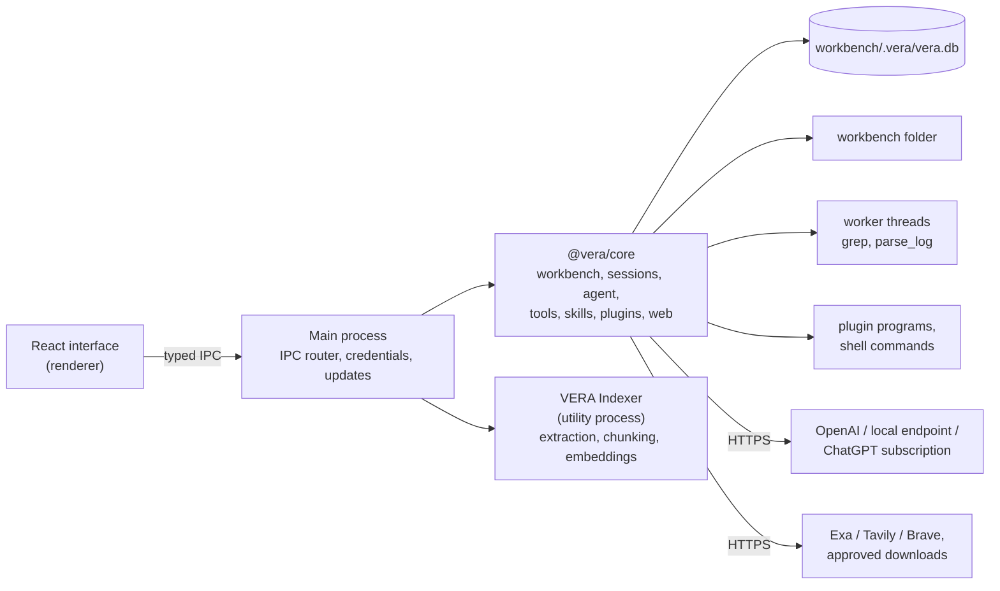

# VERA — overview

> A summary for people. It describes the state of 2026-11-18, checked against the code in
> `05_Software`. Where this page and the code disagree, the code wins, then the specifications in
> `architecture/`.

## What it is

**VERA — Virtual Embedded Rig Assistant** is a desktop application for electronics and embedded
engineers. It resembles Claude Code, Codex or opencode: a chat window with sessions, in which an AI
model works with tools. The difference is the context. You work in a **virtual workbench**, a folder
that holds everything about one project or board: datasheets, manuals, release notes, logs, internal
notes, and the skills that tell the agent how to work.

Examples:

- "What is the I2C address of the temperature sensor, and which register holds its ID?" The agent
  searches the documents, reads the datasheet page and answers with a citation: *datasheet.pdf,
  page 12*.
- "Add the initialisation steps from the manual to `notes/bringup.md`." The agent prepares the
  change, you see the diff and approve or refuse it.
- "Summarise the errors in `logs/boot-0412.log`." The agent reads the log with `parse_log` and the
  file tools and writes the summary as a session **artifact**, which you open or export.
- "Flash this firmware to the ESP32." The agent runs `esptool` through the `esp32-esptool` plugin;
  a command that writes to the device asks for your approval first.

## Concepts

| Concept | Claude Code / Codex equivalent | What it holds |
|---|---|---|
| **Workbench** | project / repository | a local folder; its configuration is in `.vera/`: `workbench.yaml`, `WORKBENCH.md`, `.veraignore`, `skills/` |
| **WORKBENCH.md** | `CLAUDE.md` / `AGENTS.md` | the fixed context: the board, the setup, the conventions; always in the prompt (at most 16 KiB) |
| **Documents** | — | the files chosen by `docs.include` (default `docs/**`): PDF, Markdown, HTML, text and Office documents (text documents, presentations, spreadsheets). `.gitignore` is honored by default, and each workbench has limits for file size and file count |
| **Tools** | tools | built-in: files (`read`, `list`, `glob`, `grep`, `write`, `edit`), documents (`search_docs`, `read_doc`), analysis (`parse_log`, `decode_register`), `load_skill`, `help`, `todo`, `artifact_save`, web (`web_search`, `web_read`, `web_download`), shell (`run_command`, `terminal_read`) and plugin programs (`run_program`, `program_output`, `program_stop`) |
| **Skills** | `SKILL.md` | expert procedures in the Agent Skills format; from the workbench's `.vera/skills/`, from the user's folder or from a plugin |
| **Plugins** | — | a manifest (`plugin.yaml`) with the external programs it uses and a risk rule per command, plus skills; installed from a catalog |
| **Session** | session | the conversation, its tool calls, approvals, changes and artifacts; it can be archived, exported and reordered |
| **Artifacts** | — | the files the agent produces in a session: reports, tables, summaries |
| **Permission mode** | permission mode | *Read-only*, *Ask* (default), *Auto-edit* and *Bypass* |

## What VERA does today

- **Platforms:** Windows x64 (per-user installer and portable archive) and Linux x64 (AppImage and
  deb), with automatic updates on the `latest` and `beta` channels.
- **Models:** the OpenAI API, OpenAI-compatible endpoints (with model discovery from LM Studio) and a
  ChatGPT subscription. The model is chosen per session, per workbench or globally. For models that
  support it, the reasoning level can be chosen too.
- **Documents:** background indexing in a separate process ("VERA Indexer"), hybrid search (keywords
  and meaning, with the local BGE-small model included in the package), verified citations, and a
  viewer with Rendered, Text and Hex modes and image preview.
- **Web:** search and reading through Exa (the default, anonymous), Tavily or Brave, configured in
  Settings. `web_download` downloads public files only with approval.
- **Safety:** every edit needs approval of the exact diff, through one write queue per workbench.
  In *Bypass* the agent reaches any folder your account can reach and requests are approved
  automatically; every switch to *Bypass* asks for confirmation. VERA's application data folder is
  refused in every mode. Stored secrets are masked per area: display, program runs, agent and model,
  artifacts and exports.
- **Shell and terminal:** the agent runs shell commands with `run_command`, with approval; in
  *Auto-edit* a saved command prefix runs without asking, and destructive commands always ask
  outside *Bypass*. The user has terminal tabs; the agent reads a terminal only with consent per
  terminal.
- **Plugins:** 43 official plugins ship in `05_Software/plugins`; see
  [Plugins for embedded tools](#plugins-for-embedded-tools).
- **Long sessions:** the context budget is computed on every call; the history is compacted above
  80 %; you can send messages during a turn.
- **Interface:** light and dark themes, six text sizes, separate sizes for chat and code, English,
  German, Romanian and French, configurable keyboard shortcuts, and help pages in the four
  languages.
- **Command line:** `vera run`, `vera index`, `vera search`, `vera plugin` and `vera catalog` use
  the same core as the application.

**Not there yet:** data migrations and upgrade safety (deferred until the first public release;
until then every stored format stays at version 1 and any other version is invalid data), images in
the chat, a multilingual embedding model, camera, voice, macOS.

**Proofs still open:** a run on a clean offline Windows, an update checked on release artifacts,
network evidence on Windows (pktmon), native Ubuntu runs of the plugin tests, and real hardware:
the plugins are tested with simulated or fake devices. The list is in `plan/README.md`.

## Key decisions

The full table, with IDs, is in `decisions/README.md`.

| Decision | Why, and how it shows in the code |
|---|---|
| TypeScript + Electron | the same stack as BenchPilot (reference code in `09_Others/benchpilot-reference/`); ChatGPT sign-in and local embeddings work in Node without a server. The interface uses hand-written CSS |
| Start from the BenchPilot reference code | the adoption stage is finished |
| `pi-ai` for models; VERA owns the agent loop | ADR-0002 and ADR-0003; steering and compaction are built on that loop |
| Workbench = folder | it can be copied and kept in Git; configuration and skills are in `.vera/`, and a second process opens the workbench read-only |
| One SQLite file per workbench | FTS5 and trigram index, vectors, sessions, artifacts; the schema is fixed (version 1), with no migrations |
| Embeddings computed locally, with the bundled model | documents do not leave the computer at indexing; the model is BGE-small q8 (ADR-0015) |
| Shell and programs only under rules | shell commands go through `run_command` with approval; external programs run only as declared by a plugin (ADR-0007, ADR-0016) |
| The agent cannot rewrite its own permissions | outside *Bypass* the file tools never write `.vera/`; VERA's application data folder is refused in every mode |
| Context budget on every call | reserves room for the answer and reduces tool results; history compaction above 80 % |
| Approval for the exact change, once | one write queue shared by all sessions; a file changed in the meantime needs a new approval; a restart does not rewrite files |
| `grep` in a worker that can be ended | 10-second deadline; Stop works even when a regular expression hangs |
| The application starts offline | the network is used for models, updates, ChatGPT sign-in, the web tools on request, and the plugin catalog and plugin dependencies on a user action |
| No size limit for the package | ADR-0017; the packaging report still shows what takes space |
| Checks on the distributed package | the instrumented build is separate; the release is tested with a simulated model on a local endpoint, and the network is checked with `strace` on Linux |

## Architecture in short

## Milestones

| Milestone | Result | State |
|---|---|---|
| M0 Foundation | the application starts securely; themes, languages, settings; spike: native modules in the package | implemented |
| M1 Reading agent | workbench, persistent sessions, context budget, grep with a deadline | implemented |
| M2 Editing and subscription | approvals on the exact diff, shared write queue, recovery after restart; artifacts, plan, ChatGPT sign-in | implemented; *Bypass* mode added |
| M3 Knowledge | indexing (PDF, Office, Markdown, text), hybrid search, citations, viewer, skills | implemented |
| M4 Delivery | installer, portable archive, AppImage, deb, automatic updates, test on the release | implemented; database migrations and the Windows release proofs stay open |
| M5 Version 1.0 | compaction, messages during a turn, export, accessibility, translations | implemented; human review of the translations is not recorded |
| Plugins and capabilities | plugin system, catalog and management, 43 official plugins, `parse_log` and `decode_register` | implemented; proofs on real hardware and native Ubuntu stay open |
| After that | shell commands and terminal, wider *Bypass*, file viewer, secret masking, bookmarks, indexing limits, help and French, delivery packages | implemented |
| Next | images in the chat, multilingual embeddings, further plugins | planned in `plan/README.md` |

The plans of M0–M5 were removed after they were merged; their text is in the Git history.

## Plugins for embedded tools

The decisions were accepted on 2026-11-01 and are implemented; the details are in `plugins/`.

- **What a plugin is.** A folder with a manifest (`plugin.yaml`) and skills. The manifest says which
  external programs it uses (esptool, idf.py, tshark…), how they are obtained, and what risk each
  command has, through rules on the command line. The skills teach the agent how to use the
  programs.
- **How the agent runs them.** Three generic tools (`run_program`, `program_output`,
  `program_stop`). They start only the programs declared by the plugins enabled in the workbench,
  with the arguments as a list, never through a shell.
- **Risk.** Five levels: `safe`, `device-read`, `device-write`, `irreversible`, `blocked`. An
  irreversible operation (burning an eFuse, secure boot, RDP 2 on STM32) needs, in the *Ask* and
  *Auto-edit* modes, the user to type a confirmation word on every call. In *Bypass* it runs without
  asking. The plugin made for such operations (`esp32-efuse`) is not selected by default in its
  pack.
- **Delivery.** VERA includes `uv`. A managed Python and the PyPI programs (esptool, pyserial,
  python-can…) are installed on a user action in the application data, without touching the user's
  Python. Large vendor suites are detected, not included.
- **Catalog.** One plugin repository with an official and a community tier and a signed index. A
  review screen comes before a first install; there are no automatic updates. Plugins have their own
  versions, independent of VERA. The user picks ecosystem packs (ten today, among them ESP32, CAN,
  Wireshark, Microchip, STM32, Arduino and electrical power) with sub-selections.
- **Own plugins.** The agent writes the manifest and the skills, validates them (`plugin_validate`)
  and, after the user's review, installs them as "trial" (`plugin_install`). Every command of a
  trial plugin asks for approval, in *Bypass* too. The agent cannot promote a plugin.
- **Platforms:** Windows x64 and Linux x64.

The 43 official plugins cover: ESP32 (serial monitor, esptool, ESP-IDF, eFuse), other boards and
frameworks (Arduino, PlatformIO, Zephyr, STM32, Microchip, MicroPython, CircuitPython, Raspberry
Pi), debug and bench tools (`probe-rs`, GDB, `binutils`, `sigrok`, SCPI instruments, power
profiling, HIL testing, lab validation), buses and networks (CAN, BLE, MQTT, Wireshark), simulation
(Renode, Wokwi, LTspice, ngspice), electronics design (KiCad, Freerouting, parts search,
calculations), electrical power and distribution (network, protection, motors, power quality,
lighting, industrial catalog) and `git`.

**Analysis capabilities** (in `capabilities/`): two built-in tools, `parse_log` (logs with cited
events) and `decode_register` (bit-by-bit decoding from a local definition), plus two skills,
`firmware-comparator` and `test-planner`, shipped in the official `analysis-skills` plugin. All four
are implemented.

## How the plan is organized

`plan/README.md` lists the open plans, the delivered plans still kept as files, the work the user
deferred and the proofs still open. The first plan, in six milestones and 38 work packages
(WP-01…WP-38), was removed after delivery, like the plans of the first plugin epics; their text is
in the Git history. Further plugins are planned in `plugins/plan.md`, and the analysis capabilities
are described in `capabilities/`.

## Reference code

VERA took over code from BenchPilot, an earlier proof of concept on the same stack. The copy of the
relevant files is in `09_Others/benchpilot-reference/`. The takeover is finished.
