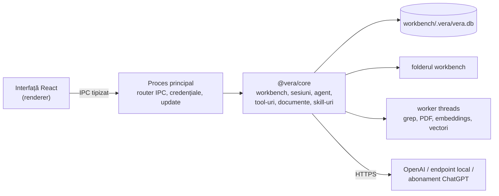

# VERA — prezentare generală

> Document pentru oameni, în română. Specificațiile, deciziile și planul de implementare sunt în
> engleză, pentru că le citesc agenții (Claude Code, Codex), iar codul și interfața sunt în engleză.
> La conflict, câștigă specificațiile din `architecture/`.

## Ce este

**VERA — Virtual Embedded Rig Assistant** este o aplicație desktop pentru ingineri de electronică și
embedded. Seamănă cu Claude Code, Codex sau opencode: o fereastră de chat cu sesiuni, în care un model
AI lucrează cu tool-uri. Diferența e contextul. Lucrezi într-un **workbench virtual**, un folder în
care pui tot ce ține de un proiect sau de o placă: datasheet-uri, manuale, release notes, log-uri,
note interne, plus skill-urile care spun agentului cum să lucreze.

Exemple:

- „Ce adresă I2C are senzorul de temperatură și ce registru citesc pentru ID?” Agentul caută în
  documente, citește pagina din datasheet și răspunde cu citat: *datasheet.pdf, pagina 12*.
- „Adaugă în `notes/bringup.md` pașii de inițializare din manual.” Agentul pregătește modificarea,
  tu vezi diff-ul și aprobi sau refuzi.
- „Fă-mi un rezumat al erorilor din `logs/boot-0412.log`.” Agentul scrie rezumatul ca **artefact** al
  sesiunii, pe care îl deschizi sau îl exporți.

## Concepte

| Concept | Echivalent Claude Code / Codex | Ce conține |
|---|---|---|
| **Workbench** | proiect / repo | un folder local: `workbench.yaml`, `WORKBENCH.md`, `docs/`, `skills/` |
| **WORKBENCH.md** | `CLAUDE.md` / `AGENTS.md` | contextul fix: placa, setup-ul, convențiile; intră mereu în prompt |
| **Documente** | — | orice fișier din `docs/`; PDF, Markdown, text și log-uri sunt indexate pentru căutare |
| **Tool-uri** | tool-uri | în v1 doar interne: citire, căutare, editare, căutare în documente, artefacte, plan |
| **Skill-uri** | `SKILL.md` | proceduri de expert, același format ca la Claude Code, Codex și pi |
| **Sesiune** | sesiune | conversația, apelurile de tool-uri, aprobările, modificările și artefactele ei |
| **Artefacte** | — | fișierele produse de agent într-o sesiune: rapoarte, tabele, rezumate |
| **Mod de permisiuni** | permission mode | *Read only*, *Ask before edits* (implicit), *Edit automatically* |

## Ce intră în v1.0 și ce nu

**Intră:** aplicație desktop pentru Windows x64 și Linux x64; workbench-uri locale; chat cu sesiuni
persistente; tool-uri interne (`read`, `list`, `glob`, `grep`, `write`, `edit`, `search_docs`,
`read_doc`, `load_skill`, `todo`, `artifact_save`); căutare în documente după cuvinte cheie și după
sens (embeddings locale); citate verificate; skill-uri; aprobarea editărilor cu diff; furnizori
OpenAI API, endpoint-uri compatibile OpenAI (Ollama, LM Studio, llama.cpp, vLLM) și abonament
ChatGPT; teme, mărimea textului, engleză, română și germană; pachete autonome și update automat.

**Nu intră în v1.0:** tool-uri wrapper peste programe externe (flash STM32 sau ESP32), serial,
cameră, voce, comenzi de shell, catalog de teste cu evaluatori, MCP, administrare de rețea, conturi
și roluri, macOS. Arhitectura le lasă loc; wrapper-ele, serialul și camera sunt primul pas după 1.0.

## Decizii cheie

| Decizie | De ce |
|---|---|
| TypeScript + Electron | același stack ca BenchPilot, al cărui cod de referință e în `09_Others/benchpilot-reference/`; abonament ChatGPT gata făcut prin `pi-ai`; embeddings locale în același proces; cameră și serial pe Windows și Linux mai târziu |
| Pornim din codul de referință BenchPilot | logica de agent, sesiunile, conexiunea la modele, login-ul ChatGPT, citatele și componentele de interfață există deja și sunt testate; se schimbă transportul (HTTP → IPC) și domeniul (testbench → workbench) |
| `pi-ai` pentru modele; bucla agentului din codul de referință | bucla de referință e testată cu același `pi-ai`; `pi-agent-core` rămâne alternativa pe care spike-ul WP-10 o măsoară |
| Abonamentul ChatGPT e acceptat | login direct din aplicație, pe lângă cheie API și endpoint-uri locale |
| Workbench = folder | se copiază, se versionează în Git, se trimite unui coleg; starea de rulare stă în `.vera/` |
| Un singur fișier SQLite per workbench | index de text (FTS5), vectori, sesiuni, artefacte, fără server de baze de date |
| Embeddings calculate local, cu modelul inclus în pachet | abonamentul ChatGPT nu include embeddings, iar documentele nu pleacă din calculator la indexare |
| Fără tool de shell în v1 | agentul nu poate rula comenzi; programele externe vin mai târziu ca wrapper-e declarate și aprobate |
| Agentul nu-și poate rescrie singur instrucțiunile | modificările la `workbench.yaml`, `WORKBENCH.md` și `skills/` cer aprobare chiar și în modul automat |
| Buget de context din M1 | fiecare apel rezervă loc pentru răspuns și reduce rezultatele tool-urilor, inclusiv în prima tură; compresia istoricului vine în M5 |
| Aprobare pentru modificarea exactă, o singură dată | toate sesiunile și salvările din interfață trec prin aceeași coadă de scriere a workbench-ului; un fișier schimbat între timp cere o nouă aprobare; restartul nu rescrie fișiere |
| `grep` într-un worker terminabil | deadline-ul și Stop rămân aplicabile chiar dacă un regex blochează worker-ul |
| Nimic descărcat la rulare | pachetul pornește offline; rețeaua e folosită doar pentru modele, update și login ChatGPT |
| Verificare pe pachetul distribuit | build-ul instrumentat rămâne separat; pachetul de release se testează offline și cu un model simulat pe endpoint local; rețeaua se verifică automat cu `strace` pe Ubuntu și manual în Windows Sandbox |
| Update cu electron-updater dintr-un feed static | orice locație HTTPS statică merge; varianta portabilă doar anunță versiunea nouă |

## Arhitectura pe scurt

## Etape

| Etapă | Rezultat |
|---|---|
| M0 Fundație | aplicația pornește securizat; teme, limbi, setări; spike: module native în pachet |
| M1 Agent de citire | deschizi un workbench, întrebi, agentul caută și citește fișiere; buget de context din prima tură, grep cu deadline, sesiuni persistente |
| M2 Editare și abonament | aprobare legată de diff-ul exact, o coadă de scriere comună sesiunilor, recuperare după restart; artefacte, plan, login cu ChatGPT |
| M3 Cunoaștere | indexarea documentelor (inclusiv PDF), căutare hibridă, citate verificate, vizualizator, skill-uri |
| M4 Livrare | installer și arhivă portabilă pentru Windows, AppImage și deb pentru Linux, update automat; test pe release offline și cu endpoint local, verificarea rețelei |
| M5 Versiunea 1.0 | compresia istoricului peste bugetarea din M1, mesaje trimise în timpul rulării, export, workbench demo, accesibilitate, traduceri, reverificarea release-ului final |
| După 1.0 | wrapper-e de tool-uri (flash), serial, cameră, voce locală, catalog de teste |

## Cum e organizat planul

`plan/` împarte lucrul în șase etape și 38 de pachete de lucru (WP-01…WP-38), câte un fișier pe
etapă. Fiecare pachet are scopul, dependențele, secțiunile de specificație de citit, fișierele
din `09_Others/benchpilot-reference/` de la care pornește și lista „gata când”. Două spike-uri confirmă devreme alegerile cu
risc: WP-05 (modulele native și modelul de embeddings în pachet) și WP-10 (bucla agentului).

## Codul de referință

VERA refolosește cod din BenchPilot, un proof of concept anterior pe același stack. Copia fișierelor
relevante e în `09_Others/benchpilot-reference/`, deci planul nu depinde de nimic din afara repository-ului. Harta exactă
e în `plan/benchpilot-reuse.md`; un fișier se copiază în `05_Software/` și se adaptează acolo.
