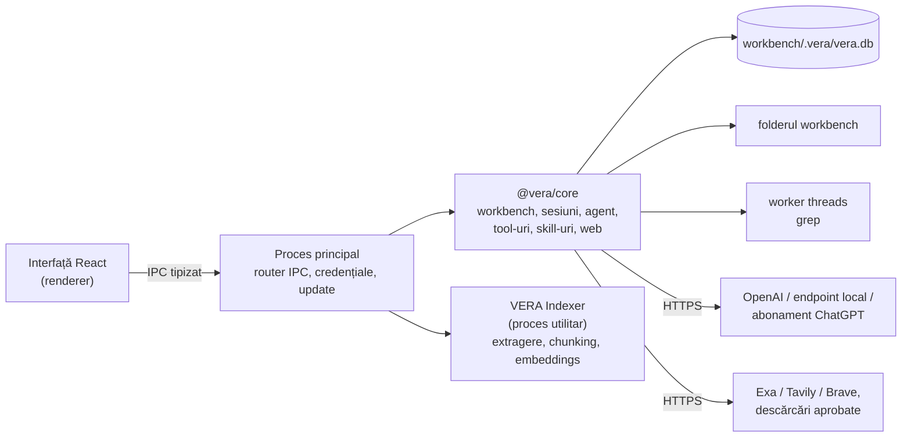

# VERA — prezentare generală

> Document pentru oameni, în română. Specificațiile, deciziile și planul de implementare sunt în
> engleză, pentru că le citesc agenții (Claude Code, Codex), iar codul și interfața sunt în engleză.
> Descrie starea din 2026-11-01, verificată pe codul din `05_Software`. La conflict câștigă codul,
> apoi specificațiile din `architecture/`.

## Ce este

**VERA — Virtual Embedded Rig Assistant** este o aplicație desktop pentru ingineri de electronică și
embedded. Seamănă cu Claude Code, Codex sau opencode: o fereastră de chat cu sesiuni, în care un model
AI lucrează cu tool-uri. Diferența e contextul. Lucrezi într-un **workbench virtual**, un folder în
care pui tot ce ține de un proiect sau de o placă: datasheet-uri, manuale, release notes, log-uri,
note interne, plus skill-urile care spun agentului cum să lucreze.

Exemple:

- „Ce adresă I2C are senzorul de temperatură și ce registru citesc pentru ID?” Agentul caută în
  documente, citește pagina din datasheet și răspunde cu citat: *datasheet.pdf, pagina 12*.
- „Adaugă în `notes/bringup.md` pașii de inițializare din manual.” Agentul pregătește modificarea,
  tu vezi diff-ul și aprobi sau refuzi.
- „Fă-mi un rezumat al erorilor din `logs/boot-0412.log`.” Agentul citește log-ul cu tool-urile de
  fișiere și scrie rezumatul ca **artefact** al sesiunii, pe care îl deschizi sau îl exporți.

## Concepte

| Concept | Echivalent Claude Code / Codex | Ce conține |
|---|---|---|
| **Workbench** | proiect / repo | un folder local; configurarea stă în `.vera/`: `workbench.yaml`, `WORKBENCH.md`, `.veraignore`, `skills/` |
| **WORKBENCH.md** | `CLAUDE.md` / `AGENTS.md` | contextul fix: placa, setup-ul, convențiile; intră mereu în prompt (maximum 16 KiB) |
| **Documente** | — | fișierele alese prin `docs.include` (implicit `docs/**`): PDF, Markdown, HTML, text, CSV/TSV și documente Office (Word/ODT, PowerPoint/ODP, Excel/ODS). Log-urile `.log` și codul nu sunt indexate; agentul le citește cu tool-urile de fișiere |
| **Tool-uri** | tool-uri | doar interne: fișiere (`read`, `list`, `glob`, `grep`, `write`, `edit`), documente (`search_docs`, `read_doc`), `load_skill`, `todo`, `artifact_save` și web (`web_search`, `web_read`, `web_download`) |
| **Skill-uri** | `SKILL.md` | proceduri de expert în formatul Agent Skills; din `.vera/skills/` al workbench-ului sau din folderul utilizatorului |
| **Sesiune** | sesiune | conversația, apelurile de tool-uri, aprobările, modificările și artefactele ei; se poate arhiva, exporta și reordona |
| **Artefacte** | — | fișierele produse de agent într-o sesiune: rapoarte, tabele, rezumate |
| **Mod de permisiuni** | permission mode | *Doar citire*, *Întreabă* (implicit), *Editare automată* și *Bypass — acces complet* |

## Ce face VERA azi

- **Platforme:** Windows x64 (installer per utilizator și arhivă portabilă) și Linux x64 (AppImage și
  deb), cu update automat dintr-un feed static, pe canalele `latest` și `beta`.
- **Modele:** OpenAI API, endpoint-uri compatibile OpenAI (cu descoperirea modelelor din LM Studio) și
  abonament ChatGPT. Modelul se alege pe sesiune, pe workbench sau global. Pentru modelele care
  suportă, se poate alege și nivelul de raționament.
- **Documente:** indexare în fundal într-un proces separat („VERA Indexer”), căutare hibridă (cuvinte
  cheie și sens, cu modelul local BGE-small inclus în pachet), citate verificate și vizualizator.
- **Web:** căutare și citire prin Exa (implicit, anonim), Tavily sau Brave, configurate în Setări.
  `web_download` descarcă fișiere publice, în special PDF-uri, doar cu aprobare.
- **Siguranță:** fiecare editare cere aprobarea diff-ului exact, într-o singură coadă de scriere pe
  workbench; restartul recuperează aprobările și scrierile întrerupte. Modul *Bypass* dă acces la
  orice fișier și aprobă automat, după un avertisment.
- **Sesiuni lungi:** bugetul de context se calculează la fiecare apel; istoricul se compactează peste
  80 %; poți trimite mesaje în timpul unei ture.
- **Interfață:** teme, șase mărimi de text, mărimi separate pentru chat și cod, engleză, română și
  germană, scurtături de tastatură configurabile, meniuri proprii în bara de titlu.
- **Linie de comandă:** `vera run`, `vera index` și `vera search` folosesc același nucleu ca aplicația.

**Încă nu există:** migrații ale bazei de date a workbench-ului (o versiune diferită a schemei e
refuzată), interfață pentru căutarea în sesiuni (căutarea există doar în nucleu), workbench-ul demo
și ghidul de început (scoase din cod pe 2026-10-26), mențiunea „unsigned build” în About, plugin-uri,
serial, cameră, voce, macOS. Pagina *Plugins* din aplicație anunță doar integrările planificate.

**Verificări rămase deschise:** rularea pe un Windows curat și offline, upgrade-ul verificat pe
artefactele de release și dovada de rețea pe Windows (pktmon).

## Decizii cheie

| Decizie | De ce, și cum arată în cod |
|---|---|
| TypeScript + Electron | același stack ca BenchPilot (cod de referință în `09_Others/benchpilot-reference/`); abonament ChatGPT gata făcut prin `pi-ai`; embeddings locale fără server. Interfața folosește CSS scris de mână; shadcn/ui e doar configurat |
| Pornim din codul de referință BenchPilot | etapa de preluare s-a încheiat; harta din `plan/benchpilot-reuse.md` e istorică |
| `pi-ai` pentru modele; bucla agentului din codul de referință | confirmată de spike-ul WP-10 (ADR-0014); steering-ul și compactarea sunt construite pe aceeași buclă |
| Workbench = folder | se copiază, se versionează în Git; configurarea și skill-urile stau în `.vera/`, iar un al doilea proces deschide workbench-ul doar pentru citire |
| Un singur fișier SQLite per workbench | index FTS5 și trigram, vectori, sesiuni, artefacte; schema e fixă (versiunea 3), fără migrații |
| Embeddings calculate local, cu modelul inclus | documentele nu pleacă din calculator la indexare; modelul ales este BGE-small q8 (ADR-0015) |
| Fără tool de shell | agentul nu poate rula comenzi; programele externe vor veni prin plugin-uri (ADR-0016, planificat) |
| Agentul nu-și poate rescrie singur instrucțiunile | în afara modului *Bypass*, `.vera/` e inaccesibil tool-urilor; configurarea se schimbă doar din aplicație |
| Buget de context la fiecare apel | rezervă loc pentru răspuns și reduce rezultatele tool-urilor; compactarea istoricului peste 80 % |
| Aprobare pentru modificarea exactă, o singură dată | o coadă de scriere comună tuturor sesiunilor; un fișier schimbat între timp cere o nouă aprobare; restartul nu rescrie fișiere |
| `grep` într-un worker terminabil | două worker-e, termen de 10 s; Stop funcționează chiar dacă un regex blochează |
| Aplicația pornește offline | rețeaua se folosește pentru modele, update, login ChatGPT, tool-urile web la cerere și, în viitor, plugin-uri |
| Fără limită de mărime pentru pachet | eliminată pe 2026-11-01 (ADR-0017); raportul de packaging arată în continuare ce ocupă loc |
| Verificare pe pachetul distribuit | build-ul instrumentat e separat; release-ul se testează cu un model simulat pe endpoint local, iar rețeaua se verifică cu `strace` pe Ubuntu |

## Arhitectura pe scurt

## Etape

| Etapă | Rezultat | Stare |
|---|---|---|
| M0 Fundație | aplicația pornește securizat; teme, limbi, setări; spike: module native în pachet | implementat |
| M1 Agent de citire | workbench, sesiuni persistente, buget de context, grep cu termen | implementat |
| M2 Editare și abonament | aprobări pe diff-ul exact, coadă de scriere comună, recuperare după restart; artefacte, plan, login ChatGPT | implementat; în plus modul *Bypass* |
| M3 Cunoaștere | indexare (PDF, Office, Markdown, text), căutare hibridă, citate, vizualizator, skill-uri | implementat; log-urile nu sunt indexate |
| M4 Livrare | installer, arhivă portabilă, AppImage, deb, update automat, test pe release | implementat; migrațiile bazei de date și dovezile de release pe Windows rămân deschise |
| M5 Versiunea 1.0 | compactare, mesaje în timpul turei, export, accesibilitate, traduceri | implementat; căutarea în sesiuni nu are interfață, workbench-ul demo a fost scos, revizuirea traducerilor de către oameni nu e consemnată |
| Următoarele | plugin-uri pentru unelte embedded, capabilități de analiză | planificate, cu tichete în Gitea |

Detaliile pe pachete de lucru sunt în secțiunile „Implementation notes” din fișierele `plan/M*.md`.

## Plugin-uri pentru unelte embedded

Decizii acceptate pe 2026-11-01, detaliate în `plugins/`. Nimic nu e implementat încă. Înlocuiesc
ideea anterioară de wrapper-e cu descriptor per comandă și modulul separat de serial.

- **Ce e un plugin.** Un folder cu un manifest (`plugin.yaml`) și skill-uri. Manifestul spune ce
  programe externe folosește (esptool, idf.py, tshark…), cum se obțin, și ce risc are fiecare
  comandă, prin reguli pe linia de comandă. Skill-urile îl învață pe agent cum se folosesc
  programele.
- **Cum le rulează agentul.** Trei tool-uri generice (`run_program`, `program_output`,
  `program_stop`). Ele pornesc doar programele declarate de plugin-urile activate în workbench, cu
  argumente ca listă, niciodată printr-un shell.
- **Risc.** Cinci niveluri: `safe`, `device-read`, `device-write`, `irreversible`, `blocked`. O
  operație ireversibilă (arderea unui eFuse, secure boot, RDP 2 pe STM32, transmisie pe un bus CAN
  real) cere în modurile *Întreabă* și *Editare automată* ca utilizatorul să tasteze subcomanda la
  fiecare apel. În *Bypass* rulează fără întrebare; la trecerea în bypass, VERA avertizează care
  reguli ireversibile sunt active. Plugin-urile dedicate unor astfel de operații (`esp32-efuse`)
  sunt dezactivate implicit.
- **Livrare.** VERA va include `uv`. Python-ul și pachetele (esptool, pyserial, python-can…) se vor
  instala la cerere în datele aplicației, fără să atingă Python-ul utilizatorului. Suitele mari
  (ESP-IDF, MPLAB X, Wireshark) sunt detectate, nu incluse. Limita de mărime a pachetului a fost
  deja eliminată.
- **Catalog.** Un singur repository de plugin-uri, cu nivel oficial și nivel comunitar.
  Plugin-urile se actualizează independent de VERA. Utilizatorul alege pachete de ecosistem (ESP32,
  CAN, Wireshark, Microchip, STM32) cu sub-selecții.
- **Plugin-uri proprii.** Agentul scrie manifestul și skill-urile, le validează și le instalează în
  mod „trial”, în care orice comandă cere aprobare, inclusiv în bypass. Doar utilizatorul îl
  promovează la plugin de încredere.
- **Platforme:** Windows x64 și Linux x64 din prima versiune.

Primul pachet este ESP32: monitor serial, esptool, ESP-IDF prin EIM, eFuse (dezactivat implicit).
Planul are 18 pachete de lucru, PLG-01…PLG-18, în trei pași; primul pas se încheie cu primul flash pe
un ESP32. În Gitea: epic-urile #54, #55, #56 și tichetele #57–#74.

**Capabilități de analiză** (în `capabilities/`, epic #75): două tool-uri interne, `parse_log`
(log-uri ESP-IDF, Zephyr și cu timestamp ISO, cu evenimente citate) și `decode_register` (decodare
bit cu bit pe baza unei definiții locale), plus două skill-uri, `firmware-comparator` și
`test-planner`, livrate în plugin-ul oficial `analysis-skills`. Nu sunt implementate încă.

## Cum e organizat planul

`plan/` conține planul inițial în șase etape și 38 de pachete de lucru (WP-01…WP-38), toate închise
în Gitea. Fișierele de etapă au rămas ca înregistrare istorică, cu note de implementare care spun ce
s-a făcut conform planului și ce diferă. Lucrul nou e planificat separat: `plugins/plan.md`
(PLG-01…18) și `capabilities/` (CAP-01…04).

## Codul de referință

VERA a preluat cod din BenchPilot, un proof of concept anterior pe același stack. Copia fișierelor
relevante e în `09_Others/benchpilot-reference/` (cu folderele `apps/` și `packages/`). Preluarea s-a
încheiat; harta din `plan/benchpilot-reuse.md` arată de unde a pornit fiecare modul.
