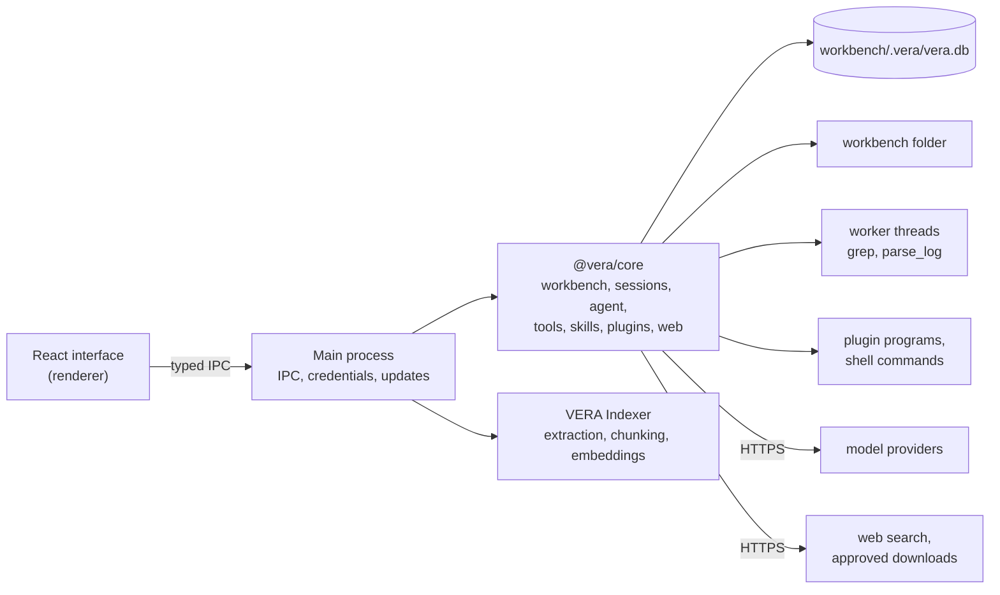

# VERA overview

**VERA, the Virtual Embedded Rig Assistant,** is a desktop application for electronics and embedded
engineers. It works like Claude Code, Codex or opencode: a chat with sessions, in which an AI model
uses tools. The difference is the context. You work in a **workbench**, a folder that holds one
project or board: datasheets, manuals, logs, notes and the skills that tell the agent how to work.
Through plugins the agent also runs the tools of the bench.

This folder defines the product as the code in `05_Software/` implements it. Where a document and
the code disagree, the code wins.

## Documents

| Document | Defines |
|---|---|
| [Overview.md](Overview.md) | the product, its concepts, the main decisions and its limits (this page) |
| [System.md](System.md) | rules, stack, processes, IPC, module boundaries, data locations, security and network |
| [Workbench.md](Workbench.md) | the workbench folder, skills, stored data, document indexing, search and citations |
| [Agent.md](Agent.md) | sessions, the agent loop, tools, permission modes, approvals, model providers, masking |
| [Plugins.md](Plugins.md) | the plugin mechanism: manifest, rules and risk levels, running, store, catalog |
| [Interface.md](Interface.md) | layout, screens, appearance, languages, help, keyboard and UI rules |
| [Delivery.md](Delivery.md) | versions, packages, updates, delivery and quality checks |

User-facing behaviour is described in the in-app help, [05_Software/help/en](../05_Software/help/en/index.md).
Project rules are in [01_Documentation](../01_Documentation/README.md).

## What a user does with it

- "What is the I2C address of the temperature sensor, and which register holds its ID?" The agent
  searches the indexed documents, reads the datasheet page and answers with a citation that opens the
  page.
- "Add the start-up steps from the manual to `notes/bringup.md`." The agent prepares the change; the
  user sees the diff and approves or refuses it.
- "Summarise the errors in `logs/boot.log`." The agent reads the log with `parse_log` and saves the
  summary as a session artifact.
- "Flash this firmware to the board." The agent runs the flashing tool of an enabled plugin; a command
  that writes to the device asks for approval first.

## Concepts

| Concept | What it is |
|---|---|
| **Workbench** | A local folder. Its configuration and runtime data are in `.vera/`: `workbench.yaml`, `WORKBENCH.md`, `.veraignore`, `skills/` and `vera.db`. |
| **WORKBENCH.md** | The fixed project context, always in the system prompt, at most 16 KiB. |
| **Documents** | The files selected by `docs.include` (default `docs/**`): PDF, Office and OpenDocument files, HTML, Markdown and text. `.gitignore` is honoured by default; file size and file count have per-workbench limits. |
| **Session** | One conversation with its tool calls, approvals, changes and artifacts. Sessions can be archived, exported, searched and reordered. |
| **Tools** | Built-in tools for files, documents, logs, registers, skills, help, plans, artifacts, the web, parts search, shell commands, terminals and plugin programs. |
| **Skills** | Procedures in the Agent Skills format (`SKILL.md`), from the workbench, the user's folder or a plugin. |
| **Plugins** | A manifest that declares external programs and a risk rule per command form, plus skills and help. Installed from a signed catalog or from a folder. |
| **Artifacts** | Files the agent produces in a session, such as reports and tables. |
| **Permission mode** | Read-only, Ask (default), Auto-edit or Bypass. It decides which writes and runs need approval. |

## What VERA does

- **Platforms:** Windows x64 (per-user installer and portable ZIP) and Linux x64 (AppImage and deb).
  Updates come on the `latest` or `beta` channel.
- **Models:** the OpenAI API, a ChatGPT subscription and any OpenAI-compatible endpoint, with model
  discovery for LM Studio. The model is chosen globally, per workbench or per session, and the
  reasoning level where the model supports it.
- **Documents:** indexing in a separate process, the VERA Indexer; hybrid keyword and semantic
  search with a local embedding model that ships in the package; verified citations; a viewer with
  Rendered, Text and Hex modes and image preview.
- **Web:** search and page reading through Exa (default, anonymous), Tavily or Brave. Files are
  downloaded only with approval, which is automatic only in Bypass.
- **Safety:** every file change is approved as the exact diff, by the user or by the permission
  mode, and written through one write queue per workbench. In Bypass the agent reaches any folder
  the OS account can reach and runs without asking; switching to Bypass asks for confirmation. VERA's own application data is refused in every
  mode. Stored secrets are masked separately on screen, in program runs, towards the model and in
  exports.
- **Shell and terminals:** the agent runs shell commands with `run_command` under the permission
  mode; in Auto-edit a saved command prefix runs without asking, and destructive forms always ask.
  The user has terminal tabs, and the agent reads a terminal only with the user's consent.
- **Plugins:** 43 official plugins cover ESP32, STM32, Microchip, Arduino, PlatformIO, Zephyr,
  MicroPython and CircuitPython boards, debug probes, buses and networks, simulators, PCB design,
  bench instruments and electrical power design. [Plugins.md](Plugins.md) defines how they work.
- **Long sessions:** the context budget is computed for every model call; the history is compacted
  above 80 % of the input budget; the user can send messages while a turn runs.
- **Interface:** light and dark themes, six text sizes, separate chat and code sizes, editable
  keyboard shortcuts, and English, German, Romanian and French, with help pages in all four.
- **Command line:** `vera run`, `vera index`, `vera search`, `vera plugin` and `vera catalog` use the
  same core as the desktop application.

## Main decisions

| Decision | Why |
|---|---|
| TypeScript on Electron, React with hand-written CSS | One Chromium on Windows and Linux; ChatGPT sign-in and local ONNX models run in Node. |
| Models through `pi-ai`; VERA owns the agent loop | One library covers the API and the subscription; the own loop keeps approvals, the context budget, steering and replay in one place. |
| A workbench is a plain folder | Engineers copy it, keep it in Git and open its files with other programs. |
| One SQLite database per workbench | Full-text, trigram and vector search, sessions and artifacts in one file at workbench scale. |
| Local embeddings with a bundled model | Documents never leave the computer when they are indexed, and no embedding API is needed. |
| Core without Electron, behind ports | The CLI runs the same core; CPU-heavy work runs in workers that can be stopped. |
| zod is the only schema language | One way to validate IPC, settings, tool input and stored data. |
| No accounts or app login | A single-user desktop application; the OS account is the boundary. |
| Approval for the exact change, used once | A file changed since the approval needs a new one; a restart never rewrites files. |
| Programs only as plugins declare them | The agent never runs an undeclared program; arguments are an array, never a shell line. |
| Risk level per command, not per program | A wrong command can damage hardware; the level decides how much confirmation is needed. |
| A signed plugin catalog with reviewed installs | Community plugins are possible while every install stays verifiable. |
| Starts offline | The network is used only for models, update and plugin catalog checks, ChatGPT sign-in, web tools on request and plugin downloads on a user action. |

## Architecture in short

## Limits

- **No data migrations.** Until the first public release every stored format stays at version 1;
  any other version is invalid data.
- **Not supported:** macOS, camera input, voice.
- **Tested with simulators.** The plugins are tested with simulated or fake devices and on WSL for
  Linux. Runs on real boards and instruments, on native Ubuntu and on a clean offline Windows
  install are not recorded yet.
- **Translations** have no recorded review by native speakers.
