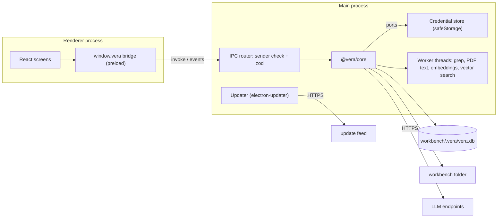

# 01 — System architecture

PURPOSE: the single source for VERA's laws, stack, process model, IPC boundary, module map, source
layout, data locations and network egress. Other specs and the work packages cite it by section.
SCOPE: VERA 1.0 (milestones M0–M5 in `../plan/README.md`). Wrapper tools, serial, camera and voice
are post-1.0 and appear here only as reserved seams.

## 1. Laws

Every work package preserves these. Changing one is an architecture decision, recorded as a new ADR in
`../decisions/`.

| # | Law |
|---|---|
| L1 | `packages/core` never imports `electron`. Host services reach it through the ports in `packages/core/src/ports.ts`. |
| L2 | The renderer has no Node access. It reaches the main process only through the typed IPC contract in `packages/shared/src/ipc.ts`, validated with zod on both sides. |
| L3 | Agent tools act only inside the open workbench root. `.vera/` is never writable by a tool. There is no shell tool. |
| L4 | Only `write` and `edit` change workbench files, and only as the session's permission mode allows. `workbench.yaml`, `WORKBENCH.md` and `skills/**` always need an explicit approval. |
| L5 | Nothing is downloaded at run time: models, fonts and assets ship in the package. |
| L6 | Outbound network goes only to the destinations in §8. VERA listens on no port, except pi-ai's OAuth callback on `127.0.0.1:1455` during a ChatGPT sign-in. No telemetry. |
| L7 | Secrets exist only in the main-process credential store (04 §5). They never reach the renderer, logs, events, the database or error text. |
| L8 | Document and file content is data, never instructions. No tool executes content. |
| L9 | Every user-facing string goes through i18n; `en` is the source catalog. Core returns error codes, not sentences. |
| L10 | A persisted-format change ships with a migration. VERA refuses data written by a newer version. |
| L11 | Automated tests never call a real model. Core and test builds use the replay provider; release-package agent tests use a scripted loopback endpoint through the normal custom-provider path (08 §3, ADR-0012). |

## 2. Stack

Versions are pinned exactly.

| Layer | Choice | Decision |
|---|---|---|
| Language | TypeScript, strict, ESM | ADR-0001 |
| Build tooling | Node.js 24 LTS, npm workspaces | ADR-0001 |
| Desktop shell | Electron, current stable when work starts | ADR-0001 |
| Build and dev server | electron-vite | ADR-0001 |
| Packaging and updates | electron-builder, electron-updater | ADR-0008 |
| UI | React 19, Vite, Tailwind CSS v4, shadcn/ui, lucide-react | ADR-0001 |
| UI data | TanStack Query for requests; the shared session reducer for event streams | §3 |
| Markdown | react-markdown, remark-gfm, rehype-highlight | 06 |
| i18n | i18next, react-i18next | 06 |
| Schemas | zod, the only schema language | ADR-0010 |
| Model access | `@earendil-works/pi-ai` | ADR-0002 |
| Agent loop | the reference loop, moved into core | ADR-0003, confirmed by WP-10 |
| Storage | SQLite through better-sqlite3, FTS5 | ADR-0005, confirmed by WP-05 |
| PDF text | pdfjs-dist (Node build) | 05 |
| Embeddings | `@huggingface/transformers` on onnxruntime-node, bundled model | ADR-0006 |
| File watching, globbing, ignore rules, diffs | chokidar, tinyglobby, ignore, diff | — |
| Tests | Vitest; Playwright for Electron | 08 |
| Starting code | `09_Others/benchpilot-reference/` (BenchPilot proof of concept, same stack) | `../plan/benchpilot-reuse.md` |

## 3. Processes and the IPC boundary



- The core runs in the main process (ADR-0009). CPU-heavy work (grep regex matching, PDF extraction,
  embeddings, vector search) runs in a worker-thread pool supplied through the `WorkerPool` port.
  Each worker runs one task at a time; the host enforces deadlines and aborts by terminating the
  task's worker and replacing it. A stalled worker does not stall IPC or cancel other workers.
- The preload script exposes one object through `contextBridge`:

```ts
interface VeraBridge {
  invoke<C extends Channel>(channel: C, request: Request<C>): Promise<Response<C>>; // rejects with VeraError
  subscribe(topic: "session", id: string, sinceSeq: number, on: (e: SessionEvent) => void): () => void;
  subscribe(topic: "workbench", id: string, on: (e: WorkbenchEvent) => void): () => void;
  subscribe(topic: "app", on: (e: AppEvent) => void): () => void;
}
type VeraError = { code: "INVALID" | "NOT_FOUND" | "CONFLICT" | "BUSY" | "DENIED" | "CONTEXT_LIMIT" | "PROVIDER" | "OFFLINE" | "INTERNAL";
                   messageKey: string; params?: Record<string, string | number> };
```

- Every channel has a zod request and response schema in `packages/shared/src/ipc.ts`. The router
  rejects a message whose sender frame is not the app's own renderer, or whose payload fails the schema.
- Events travel on one `vera:event` channel as `{ topic, id, seq?, event }`. `message.delta` and
  `tool.update` are coalesced every 50 ms. A subscriber passes `sinceSeq`; the core first replays the
  persisted events after it, then streams live ones (03 §8).

Channel catalogue (namespace `.` method):

| Namespace | Methods |
|---|---|
| `app` | `info`, `settings.get`, `settings.update`, `openExternal` (http/https only, after a UI confirmation), `chooseFolder`, `revealPath` |
| `workbench` | `create`, `open`, `close`, `recent`, `config.get`, `config.update`, `pinned.get`, `pinned.update`, `files` (path completion for `@`) |
| `session` | `list`, `create`, `get` (snapshot + `seq`), `rename`, `delete`, `send`, `stop`, `approval.decide`, `model.set`, `mode.set` |
| `docs` | `list`, `reindex`, `read`, `search` |
| `skills` | `list`, `get`, `save`, `delete` |
| `providers` | `list`, `save`, `remove`, `test`, `models`, `chatgpt.login`, `chatgpt.cancel`, `chatgpt.status`, `chatgpt.logout` |
| `artifacts` | `list`, `open`, `reveal`, `export` |
| `changes` | `list`, `get` |
| `update` | `status`, `check`, `download`, `install` |

## 4. Module map

```
packages/shared/src/        # no runtime dependencies besides zod; imported by every other package
  ipc.ts                    # channel names, request/response schemas, VeraError
  events.ts                 # SessionEvent, WorkbenchEvent, AppEvent unions
  session-state.ts          # pure reducer applySessionEvent(state, event) used by core snapshots and the renderer
  refs.ts                   # citation reference parser and formatter (05 §7)
  workbench.ts, settings.ts # file-format schemas
packages/core/src/          # Electron-agnostic (L1)
  ports.ts                  # CredentialStore, WorkerPool, PathProvider, Clock, Logger, OpenExternal
  workbench/                # create, open, validate, path guard, ignore rules, lock
  storage/                  # SQLite connection, migration runner, repositories
  sessions/                 # session service, event hub, snapshots, resume
  agent/                    # runtime, context policy, system prompt builder, permissions, approvals, limits
  tools/                    # registry and internal tools (03 §4)
  knowledge/                # ingest, extraction, chunking, keyword and vector index, hybrid search, refs
  skills/                   # discovery, frontmatter validation, resolution
  llm/                      # pi-ai collections, providers, replay provider, connection test, secret scrubber
  artifacts/, changes/      # session artifacts, workbench write queue and recorded edits
  settings/                 # settings schema migrations over a file port
apps/desktop/src/
  main/                     # lifecycle, window, IPC router, credential store, updater, worker host, portable mode
  preload/                  # contextBridge: window.vera
  renderer/                 # React app (06)
apps/cli/src/               # headless `vera` CLI over core: run a prompt, index, search
```

Dependency rules, enforced by `npm run check:boundaries` (WP-02):

| Package | May import |
|---|---|
| `shared` | zod |
| `core` | `shared`, its own dependencies; never `electron`, `react` or `apps/*` |
| `desktop/main` | `core`, `shared`, `electron` |
| `desktop/preload` | `shared`, `electron` (contextBridge, ipcRenderer only) |
| `desktop/renderer` | `shared`, UI libraries; never `core`, `electron` or Node built-ins |
| `cli` | `core`, `shared` |

## 5. Source layout

The software root is `05_Software/`:

```
05_Software/
  package.json  tsconfig.base.json   # npm workspaces
  packages/shared/  packages/core/
  apps/desktop/                       # electron.vite.config.ts, electron-builder.yml, src/{main,preload,renderer}
  apps/cli/
  fixtures/
    workbenches/demo-board/           # small fictional workbench used by tests and the demo
    llm-scripts/*.jsonl               # replay scripts for agent tests (08 §3)
    retrieval/                        # retrieval evaluation questions (05 §8)
  e2e/                                # Playwright Electron tests
  resources/models/                   # bundled embedding model (delivery decided by WP-05)
  scripts/                            # packaging, smoke, boundary and i18n checks
```

## 6. Data locations

| Data | Location |
|---|---|
| App settings, provider configuration without secrets, recent workbenches, installation id | `<userData>/settings.json` |
| Credentials, each value encrypted with safeStorage | `<userData>/credentials.json` |
| User skills, available to every workbench | `<userData>/skills/<name>/SKILL.md` |
| Logs, 7 daily files, secrets redacted | `<userData>/logs/vera-YYYY-MM-DD.log` |
| Workbench content | the workbench folder the user chose |
| Workbench runtime state | `<workbench>/.vera/` (02 §8) |
| Bundled models | `<resources>/models/`, read-only |

`<userData>` is `%APPDATA%\VERA` on Windows and `~/.config/VERA` on Linux. In portable mode (a
`vera.portable` file beside the executable) it is `<app folder>/data/`, set before `app.whenReady()`.

## 7. Electron security baseline

Checked by an automated test (WP-01). Weakening an item is an architecture decision.

- `contextIsolation: true`, `sandbox: true`, `nodeIntegration: false`, `webSecurity: true`.
- Content Security Policy: `default-src 'self'`; no remote scripts, styles or fonts.
- `will-navigate` blocked; `setWindowOpenHandler` denies every window. External links go through
  `app.openExternal` after a UI confirmation.
- `session.setPermissionRequestHandler` denies every permission. (Voice will later allow `media` for
  the app's own origin only.)
- One app instance (`requestSingleInstanceLock`); one VERA process per workbench (`.vera/lock`).
- The renderer loads only bundled files; no `remote` module, no `webview` tag.

## 8. Network egress

The complete list of outbound destinations. The release-package smoke (WP-33) checks it (08 §5).

| Destination | When | Source |
|---|---|---|
| OpenAI API (`api.openai.com`) | a session uses the OpenAI provider | pi-ai |
| Custom endpoint base URL (often `localhost`) | a session uses that endpoint | pi-ai |
| OpenAI and ChatGPT auth and model endpoints | ChatGPT sign-in, token refresh and requests | pi-ai |
| Update feed URL | update checks are enabled | electron-updater |
| Any http/https link | the user clicks it and confirms; opens in the system browser | `app.openExternal` |

## 9. Platforms and version

- Windows 10 and 11 x64: NSIS per-user installer and portable zip. Linux x64: AppImage and deb.
  macOS is outside 1.0 (ADR-0001).
- The product version (Semantic Versioning) is shown in About and compared by the updater.

NOTES:
- Reserved seams, not built in 1.0: `<workbench>/tools/` for wrapper descriptors that reuse the shape
  of an operation descriptor (input schema, policy, timeout, resources); a `devices` module for
  serial and camera; a `SpeechToText` port for voice (06 §9).
- Work packages cite this file as `01 §n`.
