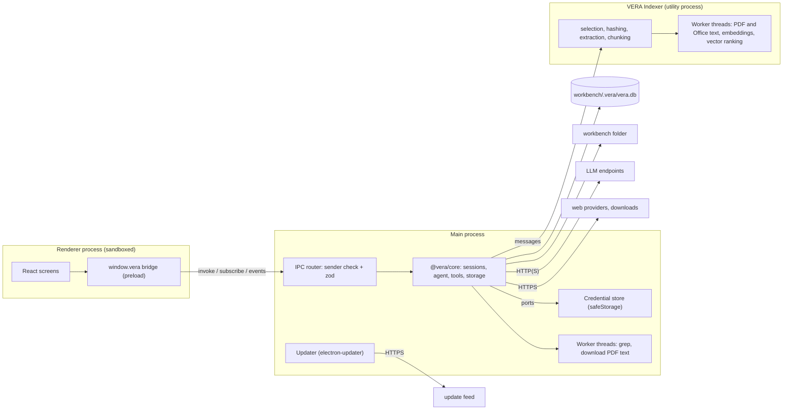

# 01 — System architecture

PURPOSE: the single source for VERA's laws, stack, process model, IPC boundary, module map, source
layout, data locations and network egress. Other specs and the work packages cite it by section.
SCOPE: VERA 1.0 (milestones M0–M5 in `../plan/README.md`). This file describes the implementation in
`05_Software/` as of 2026-11-01; anything not built yet is marked. Wrapper tools, serial, camera and
voice are post-1.0 and appear here only as reserved seams or planned plugins.

## 1. Laws

Every work package preserves these. Changing one is an architecture decision, recorded as a new ADR in
`../decisions/`.

| # | Law |
|---|---|
| L1 | `src/libraries/core` never imports `electron`. Host services reach it through the ports in `src/libraries/core/src/ports.ts` and the module ports listed in §4. |
| L2 | The renderer has no Node access. It reaches the main process only through the typed IPC contract in `src/libraries/shared/src/ipc.ts`, validated with zod on both sides. |
| L3 | Agent tools act only inside the open workbench root, and general file tools can neither read nor write `.vera/`, except in the `bypass` permission mode: there `read`, `list`, `glob`, `grep`, `write` and `edit` take filesystem scope (any ordinary absolute or relative path the OS account can reach, `.vera/` and ignore rules included, writes approved by the mode); the scope follows the live mode and is revoked on a downgrade. `artifact_save` and `web_download` write only into the managed `.vera/artifacts/` and `.vera/downloads/`. There is no shell tool. Planned, not implemented as of 2026-11-01: plugin programs are a further exception to confinement: they run without a shell under risk rules and approvals (ADR-0016, `../plugins/architecture.md`). |
| L4 | Only `write` and `edit` change user files, and only as the session's permission mode allows (`read-only`, `ask`, `auto-edit`, `bypass`). `web_download` needs the user's approval in every mode except `bypass`. Project metadata under `.vera` is managed through application APIs; outside `bypass`, general file tools cannot access it. |
| L5 | Superseded by ADR-0017: the app still starts offline with its models, fonts and assets, and plugins may download programs and runtimes at run time after a user action. Not implemented as of 2026-11-01: plugin provisioning; today's only downloads are approved `web_download` files and updates (§8). |
| L6 | Outbound network goes only to the destinations in §8. VERA listens on no external port. It listens only on loopback: pi-ai's OAuth callback on `127.0.0.1:1455` during a ChatGPT sign-in, and an ephemeral `127.0.0.1` CONNECT tunnel for the duration of each HTTPS `web_download` transfer. No telemetry. |
| L7 | Secrets exist only in the main-process credential store (04 §5); the CLI keeps them in memory, read from environment variables or `--key-file`. They never reach the renderer, logs, events, the database or error text; IPC responses, events and logs are scrubbed of every registered secret. |
| L8 | Document and file content is data, never instructions. No tool executes content. |
| L9 | Every user-facing string goes through i18n; `en` is the source catalog (`ro` and `de` also ship). Core returns error codes, not sentences. |
| L10 | Deferred until the first public release: a persisted-format change ships with a migration, and data written by a newer version is never modified. During development formats change in place at version 1: every format or schema version field is kept and is always 1, and any other value is invalid data, reported like other invalid data. Data from an earlier development build may stop loading and is deleted or recreated. There are no migrations, upgrade backups, legacy fallbacks, newer-version guards or upgrade fixtures (root `AGENTS.md`, "Development compatibility policy"; WP-32). The application's update feature (07 §5) is not part of this deferral. |
| L11 | Automated tests never call a real model. Core and test builds use the replay provider; release-package agent tests use a scripted loopback endpoint through the normal custom-provider path (08 §3, ADR-0012). Vitest projects and e2e runs block non-loopback connections (`tests/network-guard.ts`). |

## 2. Stack

Versions are pinned exactly (`.npmrc` `save-exact=true`, `engine-strict=true`).

| Layer | Choice | Decision |
|---|---|---|
| Language | TypeScript 6.0.3, strict, ESM, project references (`tsc -b`) | ADR-0001 |
| Build tooling | Node.js 24 (`engines` `>=24 <25`), npm workspaces `src/libraries/*` and `src/apps/*` | ADR-0001 |
| Desktop shell | Electron 44.7.0 | ADR-0001, ADR-0013 |
| Build and dev server | electron-vite 5.0.0 on Vite 7.3.7; the CLI is bundled with esbuild 0.25.12 | ADR-0001 |
| Packaging and updates | electron-builder 26.17.0, electron-updater 6.8.10 (generic feed) | ADR-0008 |
| UI | React 19.3.0, Tailwind CSS 4.3.3, lucide-react 1.55.0; shadcn/ui configuration (`components.json`) with one generated component (`ui/card.tsx`) on clsx and tailwind-merge | ADR-0001 |
| UI data | TanStack Query 5.104.1 for requests; the shared session reducer for event streams | §3 |
| Markdown | react-markdown 10.1.0, remark-gfm 4.0.1, rehype-highlight 7.0.2 | 06 |
| i18n | i18next 26.4.3, react-i18next 17.0.16 | 06 |
| Schemas | zod 4.6.5, the only schema language; tool parameters reach pi-ai as their JSON Schema wrapped by typebox 1.3.27 | ADR-0010, ADR-0014 |
| Model access | `@earendil-works/pi-ai` 1.1.0 | ADR-0002 |
| Agent loop | the reference loop in `core/src/agent/runtime.ts`; `@earendil-works/pi-agent-core` 1.1.0 is a dev-only experiment | ADR-0003, confirmed by ADR-0014 (WP-10) |
| Storage | SQLite through better-sqlite3 13.0.3, WAL, FTS5 (unicode61 and trigram tables) | ADR-0005, ADR-0013 |
| Document text | pdfjs-dist 6.4.299 (legacy Node build) for PDF; mammoth 1.13.0, fflate 0.8.3 and @xmldom/xmldom 0.8.15 for Office and OpenDocument; parse5 8.0.1 and mdast-util-from-markdown 2.1.0 for HTML and Markdown | 05 |
| PDF viewer | pdfjs-dist 6.4.299 in the renderer, with bundled cmaps, standard fonts and wasm | 06 |
| Embeddings | `@huggingface/transformers` 4.3.1 on onnxruntime-node 1.30.0 (CPU), bundled Xenova/bge-small-en-v1.5 q8; `@huggingface/tokenizers` 0.2.0 with the BGE tokenizer for token budgets | ADR-0006, ADR-0015 |
| Web search and read | `@modelcontextprotocol/sdk` 1.32.2 for Exa MCP; Tavily and Brave over `fetch` | 03 §4 |
| File watching, globbing, ignore rules, diffs | chokidar 5.0.0, tinyglobby 0.2.17, picomatch 4.0.7, ignore 7.0.12, diff 9.0.0 | — |
| Other runtime libraries | yaml 2.9.1 (`workbench.yaml`, skill frontmatter, update metadata), ulid 3.0.2 (ids), semver 7.8.0 (updater) | — |
| Lint and format | Biome 2.5.15 | 08 |
| Tests | Vitest 5.0.3; Playwright 1.64.0 for Electron and the browser mock mode | 08 |
| Starting code | `09_Others/benchpilot-reference/` (BenchPilot proof of concept, same stack) | `../plan/benchpilot-reuse.md` |

## 3. Processes and the IPC boundary



- The core runs in the main process (ADR-0009): sessions, agent runtime, tools, settings and every
  SQLite read and write. Document indexing runs in a separate Electron utility process, the VERA
  Indexer (`main/indexer-process.ts`, driven by `main/indexer-host.ts`): selection, hashing,
  extraction, chunking, embeddings and vector ranking. Main loads the vectors and writes the
  results. A crash fails the calls in flight with a retryable error and restarts the process; three
  crashes within 60 s stop it until `indexer.restart`. Its state reaches the renderer through
  `indexer.status` and the `indexer.status` app event (05 §1).
- CPU-heavy work runs in worker threads. In main: `grep` discovery, reads and regex matching in the
  `WorkerPool` port (`NodeWorkerPool`, 2 workers, 10 s deadline including queue time), and PDF text
  of web downloads. In the Indexer: one disposable thread per PDF or Office extraction, with a
  deadline, and one persistent embedding thread per workbench. Each worker runs one task at a time;
  the host enforces deadlines and aborts by terminating the task's worker and replacing it. A
  stalled worker does not stall IPC or cancel other workers. The CLI runs the same core and worker
  entries in its own Node process, without a utility process.
- The preload script refuses to run unless it is sandboxed and context-isolated, and exposes one
  object through `contextBridge`:

```ts
interface VeraBridge {
  invoke<C extends Channel>(channel: C, request: Request<C>): Promise<Response<C>>; // rejects with VeraError
  subscribe(topic: "session", id: string, sinceSeq: number, on: (e: SessionEvent) => void): () => void;
  subscribe(topic: "workbench", id: string, on: (e: WorkbenchEvent) => void): () => void;
  subscribe(topic: "app", on: (e: AppEvent) => void): () => void;
}
type VeraError = { code: "INVALID" | "NOT_FOUND" | "CONFLICT" | "BUSY" | "DENIED" | "CONTEXT_LIMIT" | "PROVIDER" | "OFFLINE" | "INTERNAL";
                   messageKey: string; params?: Record<string, string | number> };
```

- Three Electron IPC channels carry the contract: `vera:invoke` (every call), `vera:subscription`
  (session subscribe and unsubscribe) and `vera:event` (main to renderer).
- Every channel has a zod request and response schema in `src/libraries/shared/src/ipc.ts`. The
  bridge validates the request before sending and the result after. The router
  (`main/ipc-router.ts`) rejects a call whose sender is not the window's main frame at the expected
  renderer URL (`DENIED`), whose channel is unknown (`NOT_FOUND`) or whose payload fails the schema
  (`INVALID`). It validates every response, turns any failure that is not a `VeraError` into
  `INTERNAL`, and scrubs secrets from error keys and parameters.
- Events travel on `vera:event` as `{ topic, id, seq?, subscriptionId?, event }`, validated by
  `eventEnvelopeSchema` on both sides. A session subscriber passes `sinceSeq`; the core first replays
  the persisted events after it, then streams live ones to that subscription only (03 §8).
  `message.delta`, `reasoning.delta` and `tool.update` are coalesced every 50 ms per message or call;
  any other event flushes them first. App and workbench events are broadcast and filtered in the
  preload.

Channel catalogue (namespace `.` method):

| Namespace | Methods |
|---|---|
| `app` | `info`, `settings.get`, `settings.update`, `openExternal` (http/https only, after a UI confirmation), `chooseFolder`, `revealPath`, `openPath` (allowlisted document types inside the workbench, opened with the OS default application) |
| `window` | `menu` (native File, Edit, View and Help role menus for the hidden title bar) |
| `workbench` | `inspect`, `scanDocs`, `previewDocs`, `relativeFolder`, `create`, `open`, `close`, `recent` (remove, pin, move, reveal), `config.get`, `config.update`, `pinned.get`, `pinned.update`, `files` (path completion for `@`) |
| `session` | `list`, `search`, `create`, `get` (snapshot + `seq`), `revision`, `rename`, `archive.set`, `move`, `delete`, `export`, `send`, `stop`, `approval.decide`, `model.set`, `mode.set`, `reasoning.get`, `reasoning.set` |
| `docs` | `list`, `volume`, `search`, `open`, `reindex` |
| `indexer` | `status`, `restart` |
| `downloads` | `list`, `open` (PDF viewer content), `reveal` (by id; main locates and verifies the managed `web_download` file and shows it in the file manager, since `app.revealPath` refuses `.vera/`) |
| `skills` | `list`, `open`, `create`, `save`, `toggle` |
| `providers` | `list`, `save`, `remove`, `test`, `models`, `discover` (LM Studio), `chatgpt.login`, `chatgpt.cancel`, `chatgpt.status`, `chatgpt.logout` |
| `web.access` | `get`, `save`, `removeKey`, `test`, `cancel` |
| `artifacts` | `list`, `open`, `reveal`, `export` |
| `changes` | `list`, `get` |
| `update` | `get`, `check`, `download`, `restart`, `openRelease` (portable builds) |

Renamed from the plan: `docs.read` is `docs.open`, `skills.get` is `skills.open`, `update.status` is
`update.get`, `update.install` is `update.restart`. Not implemented as of 2026-11-01: `skills.delete`.

## 4. Module map

```
src/libraries/shared/src/        # no runtime dependencies besides zod; imported by every other package
  ipc.ts                    # channel names, request/response schemas, result envelope
  errors.ts                 # VeraError
  events.ts                 # SessionEvent, WorkbenchEvent, AppEvent unions, event envelope, VeraBridge
  session-state.ts          # pure reducer applySessionEvent(state, event) used by core snapshots and the renderer
  refs.ts                   # citation reference parser and formatter (05 §7)
  workbench.ts, settings.ts # file-format schemas
  providers.ts, chatgpt.ts, web-access.ts, updates.ts, documents.ts, downloads.ts, skills.ts,
  tools.ts, session*.ts, artifacts.ts, changes.ts, keyboard-shortcuts.ts, ordering.ts
src/libraries/core/src/          # Electron-agnostic (L1)
  ports.ts                  # CredentialStore, WorkerPool, WorkbenchHost, PathProvider, Clock, Logger, FileAccess
  workbench/                # create, open, validate, path guard, ignore rules, lock and lock guard, write queue
  storage/                  # SQLite connection, current-schema check, repositories (no migration runner)
  sessions/                 # session service, event hub, snapshots, resume, export
  agent/                    # runtime, context policy and compaction, system prompt, permissions, approvals, citations
  tools/                    # registry, the 17 built-in tools (03 §4), recorded changes, grep worker
  knowledge/                # ingest and watcher, selection, extraction, chunking, embedding host and worker,
                            # keyword and hybrid search, viewer, refs
  llm/                      # pi-ai providers and gateway, ChatGPT catalog, replay provider, connection test, secret scrubber
  web/                      # WebProvider (Exa MCP, Tavily, Brave, access gate), managed downloads and transfer
  artifacts/                # session artifact store
  skills/                   # discovery, frontmatter validation, resolution
  settings/                 # settings service (strict schema at version 1, no migrations) over a file port
  workers/                  # NodeWorkerPool, the WorkerPool implementation
src/apps/desktop/src/
  main/                     # lifecycle, window, IPC router, events, credential store, updater, worker pool,
                            # VERA Indexer host and process, data locations and portable mode, security,
                            # logger, providers and ChatGPT sign-in, web access, download transfer
  preload/                  # contextBridge: window.vera
  renderer/                 # React app (06), locales, browser mock API
src/apps/cli/src/               # headless `vera` CLI over core: run a prompt, index, search
```

Further ports live with their modules: `LlmGateway` (`llm/gateway.ts`), `EmbeddingPort`
(`knowledge/embedding.ts`), `DocumentProcessor` (`knowledge/ingest.ts`), `WebProvider`
(`web/provider.ts`), `DownloadTransferPorts` (`web/download-transfer.ts`) and `PermissionEngine`
(`agent/permissions.ts`). There is no `OpenExternal` port; the desktop main process opens links.

Dependency rules, enforced by Biome's `noRestrictedImports` overrides in `05_Software/biome.json` as
part of `npm run lint` for `core`, `shared`, `desktop/renderer` and `desktop/preload`, and covered by
`05_Software/tests/tooling/boundaries.test.ts`. The `desktop/main` and `cli` rows are conventions
without a lint rule:

| Package | May import |
|---|---|
| `shared` | zod |
| `core` | `shared`, its own dependencies; never `electron`, `react` or `src/apps/*` |
| `desktop/main` | `core`, `shared`, `electron`, electron-updater, semver, yaml, pi-ai (OAuth flows and model data) |
| `desktop/preload` | `shared`, `electron` (contextBridge, ipcRenderer only) |
| `desktop/renderer` | `shared`, UI libraries, pdfjs-dist; never `core`, `electron` or Node built-ins |
| `cli` | `core`, `shared` |

## 5. Source layout

The software root is `05_Software/`:

```
05_Software/
  package.json  package-lock.json  .npmrc   # npm workspaces, exact pins
  biome.json                              # lint, format, import boundaries
  tsconfig*.json  vitest.config.ts  playwright.config.ts
  src/
    apps/desktop/                         # Electron main/preload/renderer, electron-builder.yml
    apps/cli/                             # headless application
    libraries/shared/                     # validated contracts and data types
    libraries/core/                       # shared product logic
    models/                               # manifest (tracked) and local BGE model assets (ignored, prepared)
    windows_runtime/                      # manifest (tracked) and app-local VC++ runtime DLLs (ignored, prepared)
  tests/
    tooling/                              # configuration, build and test infrastructure
    integration/                          # CLI, documents, workers and retrieval
    packaging/                            # distribution, smoke tooling and updates
    e2e/                                  # Playwright Electron/browser acceptance
    fixtures/                             # test-only documents, scenarios and replay
    network-guard.ts, network-setup.ts    # block non-loopback connections in tests
  scripts/                                # development, packaging, model and runtime preparation, smoke, i18n
  release_tmp/                            # ignored packaging workspace
  node_modules/                           # ignored installed dependencies
```

Build output is ignored: `src/apps/desktop/out/` (electron-vite), `src/apps/cli/dist/` and the
libraries' `dist/`. Model and runtime assets are fetched and verified by `npm run prepare:model` and
`npm run prepare:windows-runtime`.

## 6. Data locations

| Data | Location |
|---|---|
| App settings (`schemaVersion` 1): preferences, provider configuration without secrets, web-access preferences, recent workbenches, session order, installation id | `<userData>/settings.json`; an unreadable or invalid file, including any other `schemaVersion`, is left untouched and stops startup |
| Credentials, each value encrypted with safeStorage; when OS encryption is unavailable (Linux `basic_text`), stored unprotected only with the user's consent, otherwise kept in memory | `<userData>/credentials.json` |
| User skills, available to every workbench | `<userData>/skills/<name>/SKILL.md` |
| Window bounds (`version` 1; an invalid, other-version or off-screen file gives centred defaults and is overwritten on close) | `<userData>/window-state.json` |
| Logs, JSON lines, 7 daily files, secrets redacted | `<userData>/logs/vera-YYYY-MM-DD.log` |
| Workbench content | the workbench folder the user chose |
| Workbench metadata and runtime state | `<workbench>/.vera/` (02 §8) |
| Bundled models | `<resources>/models/` and `<resources>/model-manifest.json`, read-only (`src/models/` in development) |

`<userData>` is `%APPDATA%\VERA` on Windows and `~/.config/VERA` on Linux (`VERA Test` for test
builds); a `--user-data-dir=<dir>` switch overrides it. In portable mode (a `vera.portable` file
beside the executable, which the portable ZIP contains) it is `<app folder>/data/`, set before
`app.whenReady()` and taking precedence over the switch. The CLI uses `--data <dir>`, or a temporary
folder removed on exit.

## 7. Electron security baseline

Checked by automated tests: `tests/e2e/shell.spec.ts` (web preferences, CSP, `window.open`) and
`src/apps/desktop/src/main/security-policy.test.ts` (session policy). Weakening an item is an
architecture decision.

- `contextIsolation: true`, `sandbox: true`, `nodeIntegration: false`, `webSecurity: true`,
  `webviewTag: false`, `spellcheck: false`. A preload error destroys the window.
- The renderer loads only bundled files, from the privileged `vera://app/` scheme
  (`main/security.ts` `bundledResponse`): GET and HEAD only, paths contained in the renderer folder
  after `realpath`, a MIME allowlist, `X-Content-Type-Options: nosniff`. Development builds load the
  Vite server at `http://127.0.0.1:5173` only. No `remote` module, no `webview` tag.
- Content Security Policy, as a `<meta>` tag and a response header: `default-src 'self'; script-src
  'self'; style-src 'self'; connect-src 'self'; worker-src 'self'; font-src 'self' blob:; object-src
  'none'; base-uri 'none'; frame-src 'none'; form-action 'none'`. No remote scripts, styles or fonts.
  The development server adds hashed inline scripts, inline styles and its websocket.
- `will-navigate` and `will-frame-navigate` blocked; `setWindowOpenHandler` denies every window;
  `will-attach-webview` prevented. External links go through `app.openExternal` after a UI
  confirmation; ChatGPT sign-in may open only `https://auth.openai.com/api/accounts/authorize`.
- Every session, from `session-created`, denies all permission requests and permission checks. Spell
  checking is off and the dictionary download URL points at `vera://`, so Chromium fetches no
  dictionaries. (Voice will later allow `media` for the app's own origin only.)
- One app instance (`requestSingleInstanceLock`); one writing VERA process per workbench
  (`.vera/lock`); another process opens that workbench read-only (02 §8).
- No application menu; the window uses a hidden title bar with a title-bar overlay, and
  `window.menu` pops up fixed native role menus, never renderer-supplied templates
  (`main/window-chrome.ts`).

## 8. Network egress

The complete list of outbound destinations. The release-package smoke (`npm run smoke:package`,
WP-33) checks that a packaged run reaches only its allowed loopback endpoint: automated with
`strace` on Linux, manual on Windows (08 §5). The app runs with HTTP/2 disabled, because datasheet
CDNs reject Chromium HTTP/2 streams.

| Destination | When | Source |
|---|---|---|
| OpenAI API (`api.openai.com`) | a session, model list or connection test uses the OpenAI provider | pi-ai |
| Custom endpoint base URL (often `localhost`; http or https, ending in `/v1`) | a session, model list or connection test uses that endpoint; LM Studio discovery reads `<origin>/api/v1/models` | pi-ai; `main/provider-discovery.ts` |
| OpenAI auth (`auth.openai.com`) and `api.openai.com` with ChatGPT tokens | ChatGPT sign-in, token refresh, model catalog and requests | pi-ai; `core/src/llm/providers.ts` |
| Update feed URL (HTTPS, compiled in from `VERA_UPDATE_URL`; none when unset) | updates are `notify` (default) or `download`, or the user checks | electron-updater generic provider |
| Exa MCP (`https://mcp.exa.ai/mcp`) | global Web access (default on, Exa, anonymous) and the workbench tool are enabled and `web_search` or `web_read` is explicitly invoked, or the user tests the provider; anonymous limits or explicitly selected own-key account quota apply | ConfiguredWebProvider gates bounded Exa MCP; optional key uses only x-api-key to this fixed endpoint; remote content URLs are read by Exa |
| Tavily REST (`https://api.tavily.com/search`, `/extract`) | explicitly selected provider and enabled tool; keyless or own-key limits | bounded JSON POST, remote public extraction; optional selected Bearer key |
| Brave Search (`https://api.search.brave.com/res/v1/web/search`) | explicitly selected provider and enabled search; own-key quota | bounded JSON GET with X-Subscription-Token; search-only, no automatic read fallback |
| Any public http/https URL given to `web_download`, and up to 5 redirects | global Web access and the tool are enabled and the user approves the download (automatic only in `bypass`) | core `WebDownloads`: public-address DNS check, ≤100 MiB; HTTPS through an anonymous in-memory Chromium session pinned to the checked address by a loopback tunnel, HTTP directly |
| Any http/https link | the user clicks it and confirms; opens in the system browser | `app.openExternal` |

Planned, not implemented as of 2026-11-01 (accepted in ADR-0016, ADR-0017 and ADR-0019):

| Destination | When | Source |
|---|---|---|
| Plugin catalog URL (`index.json`, plugin zips) | catalog browsing, a user install or an update check | plugin catalog client (ADR-0019) |
| PyPI or the configured package index; uv's CPython download host | the user installs a plugin with a `pip` or `script` program | bundled `uv` (ADR-0017) |
| URLs declared in an installed plugin's `download` entries | the user installs that plugin | plugin provisioning, SHA-256 verified |
| Whatever an external program contacts | a plugin program runs | outside VERA's control; the program's own behaviour |

## 9. Platforms and version

- Windows 10 and 11 x64: NSIS per-user one-click installer (no elevation; app data kept on
  uninstall) and portable ZIP. Linux x64: AppImage and deb. macOS is outside 1.0 (ADR-0001). Each
  platform's packages are built on that platform (`npm run package`). Windows packages carry the
  VC++ 14.44 runtime DLLs beside onnxruntime-node. Windows builds are signed and verified when a
  certificate is configured; `app.info` reports `signed` or `unsigned`.
- In-app update download and install work for NSIS and AppImage installs; the portable ZIP opens the
  release page (`update.openRelease`), and deb installs only notify. Channels are `latest` and
  `beta`; downgrades are refused and every update file needs SHA-512 metadata.
- The product version (Semantic Versioning, from `src/apps/desktop/package.json`, `0.0.0` on
  2026-11-01) is shown in the app's metadata panel and compared by the updater with semver.

NOTES:
- Reserved seams, not built in 1.0: `<workbench>/tools/` for wrapper descriptors that reuse the shape
  of an operation descriptor (input schema, policy, timeout, resources); a `devices` module for
  serial and camera; a `SpeechToText` port for voice (06 §9).
- The wrapper-descriptor and serial seams are replaced by plugins (`../plugins/architecture.md`):
  installed plugins live in `<userData>/plugins/`, serial access is the `serial-monitor` plugin, and
  no per-command descriptor exists. Not implemented as of 2026-11-01: the Settings plugin page is a
  placeholder (`renderer/components/plugins.tsx`) and no plugin code exists in core or main.
- Work packages cite this file as `01 §n`.
